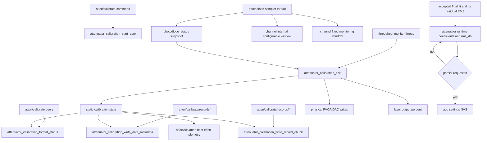
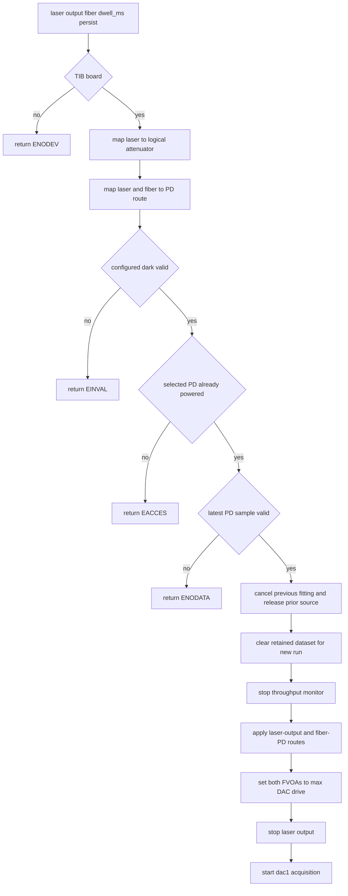
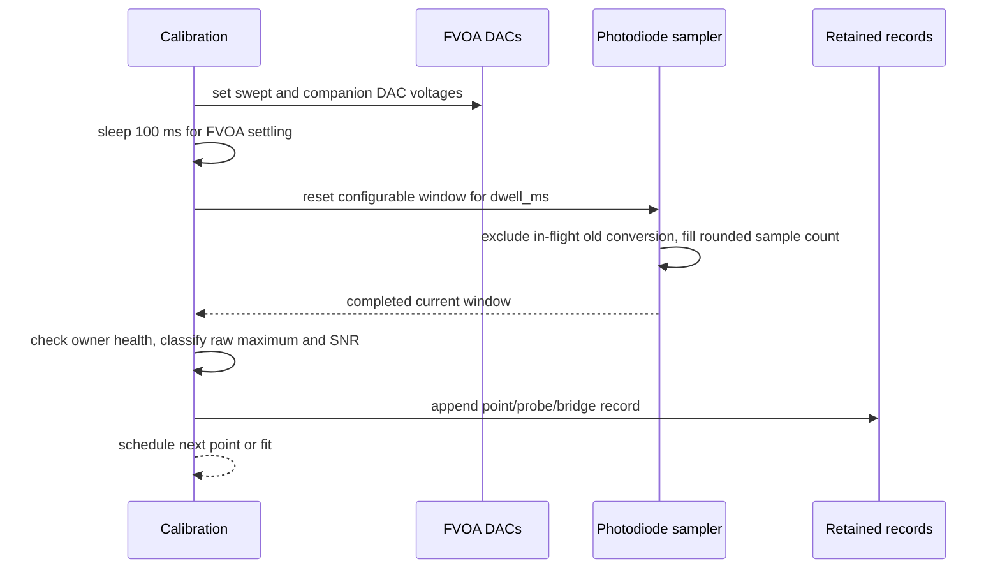
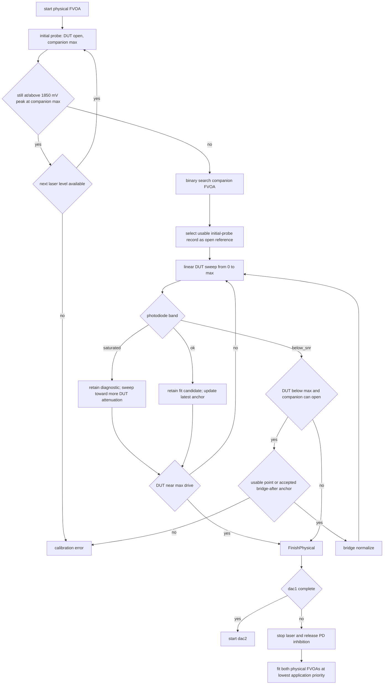
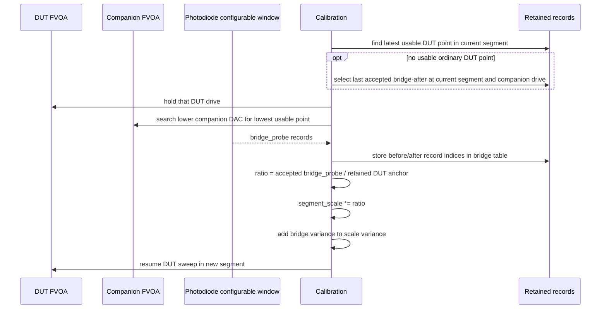
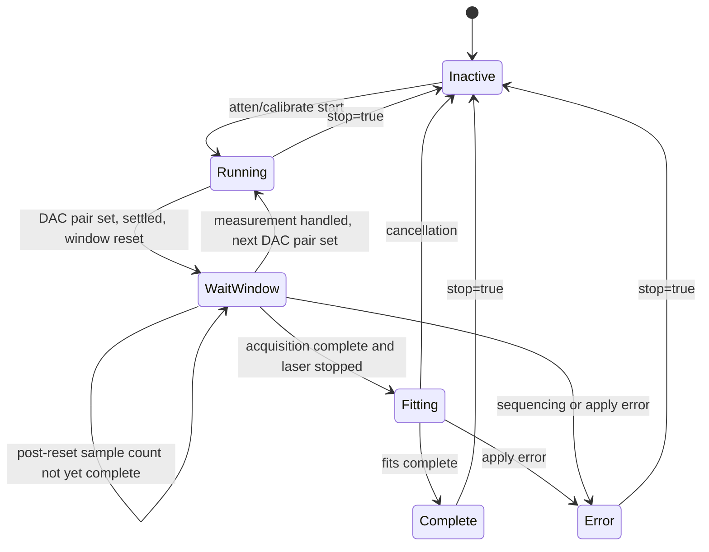
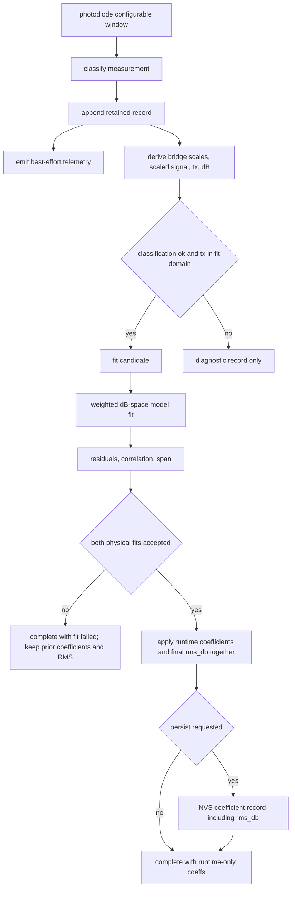

# Attenuator Calibration Flow

This page describes the current firmware implementation of automatic TIB FVOA
attenuator calibration. The [attenuator model](attenuator.md) explains the physical curve, voltage
conversion and inverse. This page explains acquisition, bridge normalization,
fitting and retained records.

Calibration is intentionally measurement driven. It does not use datasheet
voltage schedules, target photodiode voltages, fixed optical volumes, or other
preselected optical limits. The firmware finds usable regions from observed
photodiode saturation and SNR, retains every acquisition record, and fits only
records that are valid for the current attenuator model.

## Ownership



The photodiode module owns ADC reads, current samples, moving windows, and dark
snapshots. The calibration module owns sequencing, retained records, bridge
normalization, fitting, and coefficient application. The throughput monitor
thread advances calibration so no second photodiode worker or calibration
worker exists. It temporarily lowers its priority for numerical fitting and
restores it before resuming control work.

## Start Sequence



Automatic calibration does not power the photodiode or wait for a private
photodiode settle phase. The selected photodiode must already be on and already
producing valid sampler data. After setting both DACs for a measurement,
calibration waits 100 ms for FVOA settling, then resets the PD configurable
window. The PD owner rounds `dwell_ms` to whole samples;
calibration waits for that many post-reset conversion attempts.

Dark handling is separate from attenuator calibration. The calibration reads
the configured dark-subtracted photodiode configurable window; it does not
measure, update, or infer a private dark.

## Per-Point Measurement



After both DAC writes succeed, calibration sleeps for `ATTEN_CAL_SETTLE_MS`
(100 ms), allowing for the FVOAs' response time of up to 60 ms. The PD then
resets its current configurable window and excludes any conversion begun before
reset. Calibration waits for the full requested sample count and a result newer
than that reset, including failed conversion attempts in the count. Settling is
additional to `dwell_ms`: a 550 ms averaging window still collects 11 samples
after the wait. Calibration reads the current window, not the last closed window.

The sleep holds the calibration mutex and pauses its calling thread, normally
the throughput monitor, delaying throughput processing and calibration stop
access during that interval. Status reads use a separate snapshot. The ADC
sampler continues independently.
This wait applies to initial probes, ordinary sweep points, and bridge probes.
The window supplies:

- raw mean millivolts,
- dark-subtracted mean millivolts,
- raw RMS,
- propagated net-mean error,
- failed sample count,
- min/max and max raw code.

The sampler's step detection snapshots the current configurable window into the
last configurable window without resetting the current rolling window.
Calibration normally ignores the last window because it represents a prior
optical level.

## Usable-Band Model

The acquisition logic treats photodiode readings as a band:

- `saturated`: at least one valid raw reading reaches the manufacturer's
  **2000 mV photodiode saturation/linearity limit**, expressed at the ADC input
  after the divider, so the window cannot supply an unbiased calibration ratio;
- `ok`: the dark-subtracted mean is positive and has enough SNR;
- `below_snr`: the optical signal is too dim for a useful fitted point.

The photodiode limit is not an output-voltage clamp: the detector can produce
voltages beyond it and beyond the ADC range. The separate ADC clipping boundary
is **2048 mV** full scale, with a maximum reported code of **2047.9375 mV**.
Calibration therefore rejects photodiode saturation before the ADC clips.

These are not interchangeable failure modes. A saturated DUT sweep sample is
retained as a diagnostic record and the sweep continues toward more DUT
attenuation. A below-SNR DUT sweep sample marks the dim edge of the current
segment and starts bridge normalization from the latest retained usable anchor.

For the companion FVOA the DAC direction must be read carefully: lower companion
DAC opens the companion and raises photodiode signal; higher companion DAC
attenuates more. Companion searches maintain a low-DAC too-bright side, a
more-attenuated high-DAC side, and the lowest usable companion DAC candidate
whose raw window maximum is below **1850 mV** (`ATTEN_CAL_SEARCH_MAX_MV`).
This search target leaves headroom for fluctuations and increased transmission
later in the sweep. It does not change the **2000 mV photodiode** saturation classification:
a usable record between these limits remains `ok` but is not a search candidate.
Initial-reference and bridge searches, including their fallback/recovery paths,
use the same target.

## Per-Physical Acquisition

Each logical attenuator has two physical FVOAs. Calibration runs the same
sequence for `dac1` and then `dac2`.



The initial probe protects the photodiode by starting with the companion FVOA
at maximum attenuation. If even that reaches the 1850 mV peak target, firmware
retries with lower laser output levels. The companion binary search finds the most open
companion setting with usable SNR and a raw window maximum below the target.

The selected open reference is a measured `initial_probe` record named by
metadata. Firmware does not append a separate reference copy and does not
repeat the measurement solely to confirm it. If the initial companion search
cannot find a usable candidate, the acquisition errors because no valid
normalization point exists for that physical FVOA.

The DUT sweep is linear and classification-aware. It starts at 0 mV and advances
by `ATTEN_CAL_SWEEP_STEP_MV` until full DAC drive. A usable point updates the
latest bridge anchor. A saturated point is too bright, so it also advances to
the next linear DUT step but is not a fit candidate and does not become a bridge
trigger. A below-SNR point marks the dim edge of the current segment. When that
dim edge appears before the DUT reaches full drive and the companion can still
open, firmware performs bridge normalization. The similarly named
`ATTEN_CAL_SEARCH_MIN_STEP_MV` is only the minimum bracket width for
companion-FVOA binary searches.

## Bridge Normalization



Because the DUT FVOA does not move during the bridge, the before/after
photodiode ratio measures only the change in companion transmission. The
before side is the latest usable retained `point` in the segment being closed.
If no such point exists, firmware uses the last accepted bridge's after record,
provided it is classified `ok`, belongs to the current segment, and has the
current companion DAC voltage. Other retained search probes are not eligible
for this fallback. Firmware logs the selected fallback record and DAC pair.
The after side is the accepted retained `bridge_probe` in the new segment.
Those record indices are stored in the bridge table rather than copied into
synthetic records. Later DUT measurements are divided by the cumulative segment
scale so all segments share the open-reference normalization.

If a bridge search cannot find a usable companion point, firmware either
tightens the too-bright-side search floor and keeps probing or finishes the
physical when the search demonstrates that the current bridge would add no more
useful attenuation range. A single below-SNR sweep point immediately after a
bridge does not establish the end of the physical range: the accepted
bridge-after record can anchor another search with the DUT held at its voltage.
If neither an ordinary point nor the accepted bridge-after record qualifies,
acquisition fails with `-ERANGE`. Reaching full DUT drive or an already fully
open companion still finishes the physical sweep.

## Tick State



The 100 ms settling sleep occurs inside measurement scheduling without a new
state-machine phase. `WaitWindow` then waits for the configured sample count in
the current internal photodiode configurable window.

## Records, Telemetry, and Fit



Every retained dataset is available through
`atten/calibrate/records/<dac1|dac2>` followed by numbered
`atten/calibrate/records/<dac1|dac2>/<chunk>` record chunks. The first response
contains HAC4 metadata: state, fit flags, record size, records per chunk,
record count, record chunk count, selected open-reference record, and bridge
before/after record indices. Each numbered chunk contains only raw records.
Telemetry on `dt/<device>/atten` is useful for live monitoring but is not the
authoritative dataset.

There is one static dataset shared with laser calibration, cleared in place
when either calibration accepts a new start or by reboot. Downloads for the
replaced dataset return unavailable; applied coefficients remain. Stop, acquisition errors, rejected fits, and notebook cleanup retain
all acquired records, reference indices, bridge tables, run identity, and completed
fit results. Invalid requests leave it intact. Once a new run is accepted, a setup
failure belongs to that new run and leaves its empty or partial dataset available.
Python downloads each physical device's prefix from its initial metadata; records
appended afterward are left for the next download. A replacement start invalidates
an in-progress multi-request download.

Fitting reads the same immutable records with no calibration mutex held. The
throughput thread uses `K_LOWEST_APPLICATION_THREAD_PRIO` (currently 14), so normal
housekeeping, commands, Modbus parsing, and logging preempt calculation. There are
no periodic fitting sleeps or CPU budgets. Each completed physical result is
published under a short lock; raw record downloads and status remain available.
Start/stop commands signal cancellation and wait on a semaphore without holding
the mutex. Optimizer/evaluation loops check cancellation and unwind normally.
The previous calculation must return before a new start clears the records.
Priority returns to 3 outside any mutex before finalization, where cancellation
and coefficient installation serialize. Canceled work cannot install results;
already installed coefficients are not rolled back by a later stop.

Saturation classification uses the raw window maximum reaching the 2000 mV
usable-input limit, before dark subtraction. A partly clipped window can have a
plausible mean and S/N while biasing normalization, so even an isolated overrange
reading excludes that window from references, bridge anchors, and fitting.
Saturated sweep records remain available for diagnosis and do not trigger bridge
normalization. Below-SNR sweep records trigger a bridge unless the DUT is
already at the end of the firmware drive range.

Retained records store raw acquisition facts only: `sweep_mv`, `other_mv`,
`laser_pct`, `signal_mv`, `signal_err_mv`, `max_mv`, `event`,
`classification`, and `segment`. The Python helper keeps those firmware names
and adds `fvoa_mv` and `other_fvoa_mv` as host-side plotting coordinates
derived from DAC millivolts and the default FVOA drive gain. Bridge scale,
scaled signal, relative transmission, dB attenuation, fit inclusion, and
residuals are computed from the raw records and accepted bridge boundaries
after acquisition.

The retained record events are:

| Event | Meaning |
| --- | --- |
| `point` | ordinary DUT sweep point |
| `initial_probe` | companion-search point before the open reference |
| `bridge_probe` | companion-search point during bridge normalization |

The open reference, bridge-before, and bridge-after roles are metadata indices
into these retained records. They are plotted as roles by host tools but are
not separate firmware event values.

With net signal $S$, open reference $S_0$, bridge before/after readings
$S_j^-,S_j^+$, and cumulative companion scale $Q_k$:

```{math}
R_j=\frac{S_j^+}{S_j^-},\qquad Q_0=1,\qquad Q_k=\prod_{j<k}R_j,
\qquad T_k=\frac{S_k}{S_0Q_k}.
```

For example, a fixed-DUT bridge from 100 to 1000 mV gives $R=10$. A later
50 mV reading relative to a 1000 mV open reference is $T=50/(1000\times10)=0.005$,
or 23.0103 dB. The bridge measures companion transmission without relying on
that companion's prior calibration.

The reference is a measured signal, so valid sweep readings can have `tx >= 1`.
These remain fit inputs with signed measured attenuation: for example, `tx = 1.04`
is approximately -0.17 dB relative to the reference. Removing such points would
select only the dimmer fluctuations near the open end. Saturation and SNR checks
still apply, and the minimum fit transmission remains `1e-10`. The physical model
remains nonnegative and monotonic; a negative measurement contributes its full
residual rather than being clamped to zero.

The propagated relative variance is:

```{math}
\left(\frac{\sigma_{R_j}}{R_j}\right)^2=
 \left(\frac{\sigma_{S_j^+}}{S_j^+}\right)^2+
 \left(\frac{\sigma_{S_j^-}}{S_j^-}\right)^2,\qquad
\left(\frac{\sigma_{Q_k}}{Q_k}\right)^2=\sum_{j<k}
 \left(\frac{\sigma_{R_j}}{R_j}\right)^2,
```

```{math}
\left(\frac{\sigma_{T_k}}{T_k}\right)^2=
 \left(\frac{\sigma_{S_k}}{S_k}\right)^2+
 \left(\frac{\sigma_{S_0}}{S_0}\right)^2+
 \left(\frac{\sigma_{Q_k}}{Q_k}\right)^2,\qquad
A_k=-10\log_{10}T_k,\quad
\sigma_{A_k}=\frac{10}{\ln10}\frac{\sigma_{T_k}}{T_k}.
```

These are the implemented independent-term approximations. Reused references,
bridges and dark offsets correlate errors between points; the fit does not carry
a full covariance matrix. See [error interpretation](mathematics.md).

The fit minimizes $\sum_i w_i[A(v_i)-A_i]^2$. Signal/reference/bridge
propagation supplies $\sigma_{A_i}$ above; the model adds DAC and floor sensitivity:

```{math}
\sigma_i=\max\left[0.5\ {\rm dB},\sqrt{\sigma_{A_i}^2+
 \left(\frac{\partial A}{\partial v}\,3\ {\rm mV}\right)^2+
 \left(\frac{\partial A}{\partial L}\,\sigma_L\right)^2}\right],\qquad
w_i=1/\sigma_i^2.
```

The 3 mV DAC-output uncertainty is a fitting assumption, distinct from the
10 mV post-amplifier temporal-noise assumption used by runtime throughput.
$\sigma_L$ is the last-three points' sample standard deviation divided by
$\sqrt3$, with a minimum $0.5/\sqrt3$ dB. Weights are recomputed at each model
candidate; the local Jacobian uses $(\partial A/\partial p)/\sigma_i$ without
differentiating $\sigma_i$. It holds gain and leakage floor fixed while fitting
`fvoa_50pct_mv` and `slope_inv_fvoa_mv` with the
[shared optimizer](calibration_fitting.md).

**Current implementation requiring review:** `estimate_max_atten_db()` computes
$L=\max(\overline{A}_{\rm last\ three},65\ \mathrm{dB})$. The previous description
said the last-three mean alone defined the measured leakage floor. The 65 dB
minimum is a model constraint, not measured support. Whether it is intended is
recorded in the [owner ledger](human_review_required.md#decisions-to-make);
this documentation audit does not change the fitter.

The operating ceiling is `ATTENUATOR_CALIBRATED_MAX_DB` (55 dB per physical FVOA).
Low-priority fitting and cancellation, described above, preserve fit order,
arithmetic, acceptance rules, and health deadlines. Other work on the throughput
thread waits for fitting to finish; status and raw-record access remain responsive.

Acquisition still covers the complete voltage range. Both the base fit and the
optional Chebyshev correction use the same retained prefix, including the first
above-ceiling point so the boundary has measured support on both sides. The [model's Chebyshev correction](attenuator.md) keeps its full-floor
coordinates and is not forced to zero at 55 dB. The fitter tries six leading terms, then five, down to one,
refitting the smaller normal equation each time and zeroing unused coefficient
slots. It keeps the first valid final curve. The base-only model is the last
fallback; no error-budget threshold or regularization parameter is introduced.

Every candidate receives its calibrated limit and continuation before validation.
Firmware checks finite, nonnegative, ordered values and nonnegative analytic slopes
on a 1 mV grid across the drive range, at retained fit voltages, and at the calibrated
join and its adjacent float voltages. This covers the open region even when clipping
left no fit points there. Increasing sampled values alone can hide a turn between
points. The grid is a numerical check, not a proof between its locations. Unused raw
polynomial behavior above the calibrated endpoint does not reject a valid continuation.

The installed `max_calibrated_db` is the minimum of 55 dB, the last supporting
measurement, its corrected-model prediction, and the leakage floor. It is separate
from `max_atten_db`, which still sets that inferred floor. The [continuous tail](attenuator.md) is used by forward evaluation,
inverse commands and local sensitivities.

The final, unweighted residual RMS

```{math}
\mathrm{RMS}_{\rm dB}=\sqrt{\frac{1}{N}\sum_{i\in\mathrm{scored}}[A(v_i)-A_i]^2}
```

is installed as
`rms_db` with each accepted physical model. Correlation and maximum absolute
residual use the same scored points: fitting-support measurements whose **measured**
attenuation is at or below `max_calibrated_db`, including negative reference-relative
measurements. The extra above-limit point constrains
the fit but does not enter these metrics. An in-range measurement with an
out-of-range prediction still contributes its full error. The reported `points`
and transmission/voltage spans describe all fitting support, including that anchor.

The lab plots all valid sweep measurements and their signed residuals. Captured
firmware metrics are kept separate from an offline all-valid-point RMS. Raw records
do not carry per-point fit-inclusion flags: host tools only mark inferred support
when the current-rule prefix count matches the captured fit count. A mismatch
leaves support unmarked rather than assigning today's eligibility to an older fit.

The same stored RMS remains in runtime uncertainty estimates, but it does not
establish accuracy above `max_calibrated_db`. It is not a parameter standard error
and is not divided by sqrt(point count) again. This can be conservative in regions
with smaller residuals.

Both physical fits must be accepted before installation. Failure leaves the
previous coefficients and their RMS unchanged. Persistence saves RMS with the
coefficient record; a new manual model without `rms_db` uses the 2 dB default.
Manual dB, linear and voltage commands retain access to the full drive range; attenuation above the
calibrated boundary is approximate. Autolevel bounds each device by the smaller
of its stored calibrated limit, the 55 dB ceiling and its reachable drive range.
It uses laser adjustment after reaching those limits.

Coefficients and residual RMS are saved together when persistence is requested.
The current schema-14 policy clears all older app NVS records; it does not preserve
other settings across that schema reset. See [settings](settings.md) for the exact
reset boundary and [runtime uncertainty](attenuator.md#transmission-uncertainty)
for how installed RMS is used.

## Notebook Inspection

`tools/attenuator_calibration_lab.ipynb` is the lab-side inspection script for
this flow. It has two intentionally separate paths:

- the embedded path runs `atten_calibrate`, retrieves
  `atten_calibration_data`, and plots retained records, bridge events,
  residuals, and the coefficient-derived 2D attenuation surface;
- the manual exploration path directly calls `atten()`, sleeps for the
  configured dwell, and reads `pd()` so SNR, saturation, bridge, and fit
  thresholds can be changed quickly.

The manual path supports both the firmware-style weighted fit and a SciPy
least-squares exploratory fit. Its plots show propagated photodiode and
normalization uncertainty; coefficients should be reviewed before any
`atten_coeff(..., persist=True)` command is used.

A coefficient object has this shape (illustrative values, not a calibration
for an installed device):

```json
{
  "fvoa_50pct_mv": 3144.95,
  "slope_inv_fvoa_mv": 0.00303104,
  "max_atten_db": 65.0,
  "max_calibrated_db": 55.0,
  "gain": 1.533,
  "rms_db": 0.75,
  "correction_coeff": [0.12, -0.03, 0.01, 0.0, 0.0, 0.0]
}
```

## Power lifetime and correction validation

Calibration holds its selected PD's auto-off inhibition for acquisition, including
same-channel restart. It checks relay and source operational health before using
each completed window. Faults terminate acquisition and attempt laser shutdown;
a failed shutdown retains its identity for an explicit stop/restart. Numerical
fitting needs no PD power and releases inhibition when acquisition completes.
Completion also stops the calibration-owned laser before entering fitting; a
failed stop preserves measurements and shutdown responsibility and reports an
error without fitting. An explicit stop during acquisition also stops that source.

All six coefficients (`T0` through `T5`) participate in the basis, evaluator, and
analytic derivatives; reduced-order fits zero the unused high-order slots.
`atten_correction_rejected` summarizes a reduced-order or base-only result once per
physical device, including the selected term count and first failed check, voltage,
value and slope. The summary also goes to the local log. `terms=0` is base-only;
`terms=-1` means no valid candidate, including the base model. `fit=ok` indicates an
accepted final model and does not alone establish that optional correction was accepted; inspect its
coefficients and warnings.

### Compact calibration status

The aggregate status includes each model's coefficients, `max_calibrated_db`,
acceptance, point count, floor uncertainty, correlation, RMS and maximum error.
Diagnostic scalars use six significant digits and progress voltages three decimal
places; coefficient precision is retained. `min_tx`, `max_tx` and `fvoa_span_mv`
remain in the per-device fit telemetry but are omitted from aggregate status and
therefore are absent from newly fetched dataset metadata. The response is bounded by the command payload capacity.

The shape optimizer is shared with laser calibration; physical acceptance and
the correction solver belong to the attenuator owner. The
raw/bridge arrays and fit scratch reuse typed unions in `calibration_storage.c`;
no additional large array is allocated for the laser sweep.
