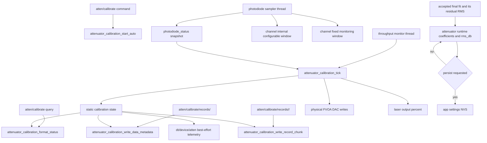
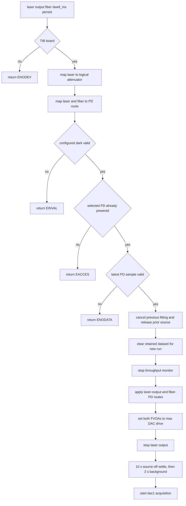
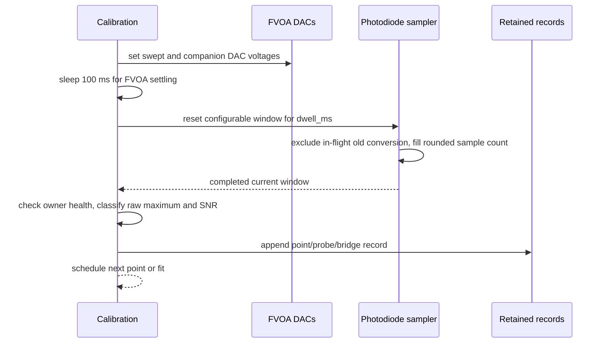
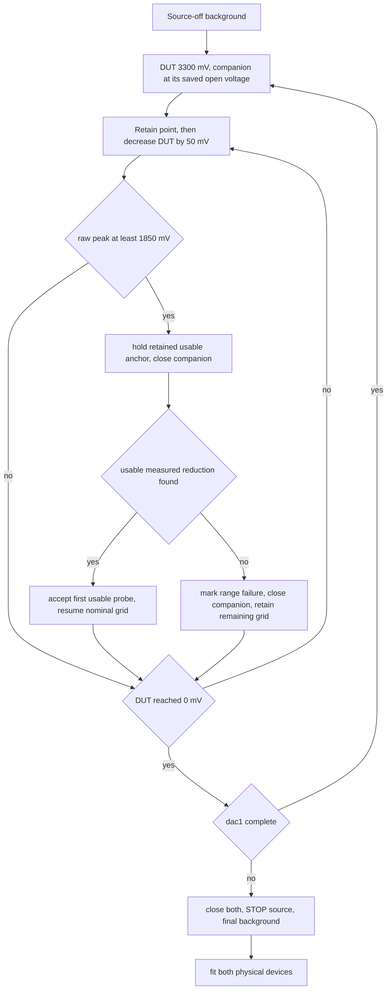
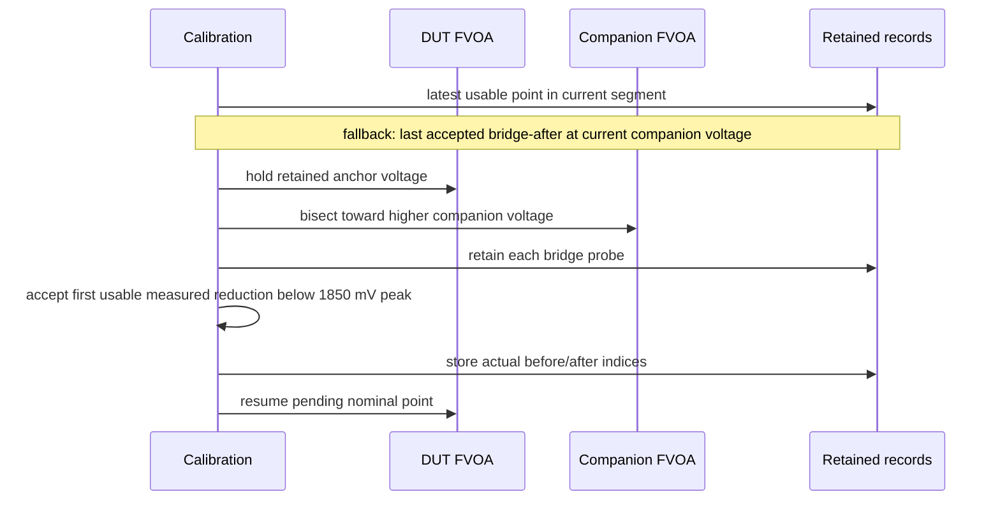
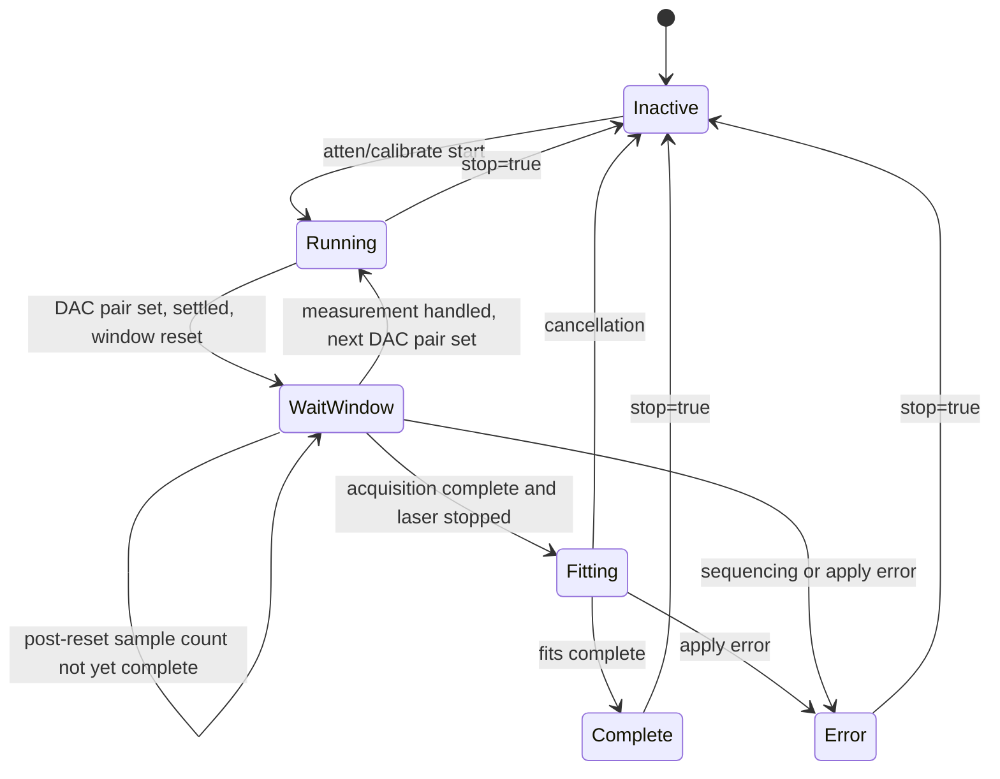
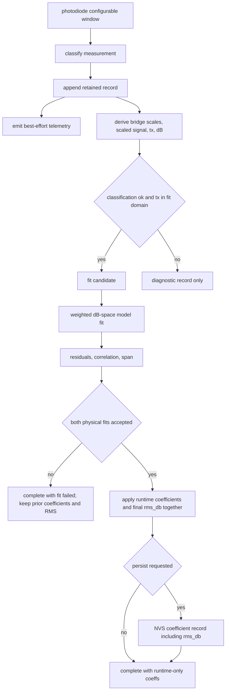

# Attenuator Calibration Flow

This page describes the current firmware implementation of automatic TIB FVOA
attenuator calibration. The [attenuator model](attenuator.md) explains the physical curve, voltage
conversion and inverse. This page explains acquisition, bridge normalization,
fitting and retained records.

Calibration is intentionally measurement driven. It does not use datasheet
voltage schedules, target photodiode voltages, fixed optical volumes, or other
preselected optical limits. The firmware finds usable regions from observed
photodiode saturation and SNR, retains every acquisition record, and fits only
records that are valid for the current attenuator model.

## Ownership



The photodiode module owns ADC reads, current samples, moving windows, and dark
snapshots. The calibration module owns sequencing, retained records, bridge
normalization, fitting, and coefficient application. The throughput monitor
thread advances calibration so no second photodiode worker or calibration
worker exists. It temporarily lowers its priority for numerical fitting and
restores it before resuming control work.

## Start Sequence



Automatic calibration does not power the photodiode or wait for a private
photodiode settle phase. The selected photodiode must already be on and already
producing valid sampler data. After setting both DACs for a measurement,
calibration waits 100 ms for FVOA settling, then resets the PD configurable
window. The PD owner rounds `dwell_ms` to whole samples;
calibration waits for that many post-reset conversion attempts.

The configured PD dark remains unchanged. Before the first sweep and after the
second, confirmed laser STOP is followed by 10 s settling and a 2 s source-off
window, with both FVOAs closed. These retained `dark_before` and `dark_after`
records supply a run-local background correction and drift uncertainty for fitting;
they do not overwrite the configured PD dark. Zero or negative source-off readings
are valid; clipping or no valid ADC samples is an acquisition error.

## Per-Point Measurement



After both DAC writes succeed, calibration sleeps for `ATTEN_CAL_SETTLE_MS`
(100 ms), allowing for the FVOAs' response time of up to 60 ms. The PD then
resets its current configurable window and excludes any conversion begun before
reset. Calibration waits for the full requested sample count and a result newer
than that reset, including failed conversion attempts in the count. Settling is
additional to `dwell_ms`: a 550 ms averaging window still collects 11 samples
after the wait. Calibration reads the current window, not the last closed window.

The sleep holds the calibration mutex and pauses its calling thread, normally
the throughput monitor, delaying throughput processing and calibration stop
access during that interval. Status reads use a separate snapshot. The ADC
sampler continues independently.
This wait applies to ordinary sweep points and bridge probes.
The window supplies:

- raw mean millivolts,
- dark-subtracted mean millivolts,
- raw RMS,
- propagated net-mean error,
- failed sample count,
- min/max and max raw code.

The sampler's step detection snapshots the current configurable window into the
last configurable window without resetting the current rolling window.
Calibration normally ignores the last window because it represents a prior
optical level.

## Usable-Band Model

The acquisition logic treats photodiode readings as a band:

- `saturated`: at least one valid raw reading reaches the manufacturer's
  **2000 mV photodiode saturation/linearity limit**, expressed at the ADC input
  after the divider, so the window cannot supply an unbiased calibration ratio;
- `ok`: the dark-subtracted mean is positive and has enough SNR;
- `below_snr`: the optical signal is too dim for a useful fitted point.

The photodiode limit is not an output-voltage clamp: the detector can produce
voltages beyond it and beyond the ADC range. The separate ADC clipping boundary
is **2048 mV** full scale, with a maximum reported code of **2047.9375 mV**.
Calibration therefore rejects photodiode saturation before the ADC clips.

The sweep runs from closed to open. Below-SNR points are retained and the DUT
continues opening. A raw peak at or above **1850 mV** triggers a companion-closing
bridge before the detector's 2000 mV validity limit. The 1850 mV value is headroom,
not a different saturation classification. A clipped point is retained and retried
at the same nominal DUT voltage after a successful bridge.

## Per-Physical Acquisition

Each logical attenuator contains two physical FVOAs. Calibration sweeps `dac1`
and then `dac2`, at a fixed **100% laser setting** throughout illuminated acquisition.
There is no laser-level ranging or assumption that a bridge ratio remains valid
across different laser powers.



The nominal DUT grid is 3300, 3250, ..., 0 mV. The companion starts at its frozen
operational open setting, rounded upward to a representable DAC code. Acquisition
can explore below an operational open setting; ordinary engineering-voltage
commands also retain unrestricted 0–3300 mV access.

Each physical device has 128 record slots. DAC1's first slot holds `dark_before`;
DAC2 reserves its final slot for `dark_after`. Bridge probes reserve enough room
for every remaining nominal point and the final source-off record. An unlinked
range rejects the fit but does not discard the remaining voltage sweep. I/O faults
or explicit STOP can terminate acquisition. Completion and cleanup park both
outputs at maximum drive.

## Bridge Normalization



The bridge holds DUT voltage and laser setting fixed. Its measured ratio therefore
normalizes the change in companion transmission without relying on the companion's
calibration. The before record is the latest usable ordinary point in the current
segment, or the last accepted bridge-after when no such point exists and its
companion voltage still matches. Arbitrary search probes are not fallback anchors.
There are no extra pre/post confirmation measurements.

The companion search brackets its current voltage and maximum drive. It accepts
the **first** usable reduction with raw peak below 1850 mV and propagated ratio
uncertainty at most **0.5 dB**, the existing model-fitting uncertainty floor.
Both readings are corrected using the retained `dark_before` mean and error.
This precision margin keeps a barely detectable bridge from placing the
remaining open-side sweep at the detector floor; it does not target a brightness
or a fraction of the anchor. Too-dim or imprecise reductions move the closed side inward; other failed
probes move the open side inward. A 5 mV bracket, 16-probe limit, exhausted record
budget, missing anchor, or already-closed companion ends the search. Failure parks
the companion closed and marks the physical fit `range`; acquisition retains the
remaining grid. Successful bridges resume at the next DUT point, or retry the
same point if its previous window was clipped. It does not search for the brightest
usable bridge or a prescribed fraction of the anchor.

## Tick State



The 100 ms settling sleep occurs inside measurement scheduling without a new
state-machine phase. `WaitWindow` then waits for the configured sample count in
the current internal photodiode configurable window.

## Records, Telemetry, and Fit



Every retained dataset is available through
`atten/calibrate/records/<dac1|dac2>` followed by numbered
`atten/calibrate/records/<dac1|dac2>/<chunk>` record chunks. The first response
contains HAC4 metadata: state, fit flags, record size, records per chunk,
record count, record chunk count, selected reference, background/error, operational
open voltage/loss, rejection reason, exact support mask, and bridge before/after indices. Each numbered chunk contains only raw records.
Telemetry on `dt/<device>/atten` is useful for live monitoring but is not the
authoritative dataset.

There is one static dataset shared with laser calibration, cleared in place
when either calibration accepts a new start or by reboot. Downloads for the
replaced dataset return unavailable; applied coefficients remain. Stop, acquisition errors, rejected fits, and notebook cleanup retain
all acquired records, reference indices, bridge tables, run identity, and completed
fit results. Invalid requests leave it intact. Once a new run is accepted, a setup
failure belongs to that new run and leaves its empty or partial dataset available.
Python downloads each physical device's prefix from its initial metadata; records
appended afterward are left for the next download. A replacement start invalidates
an in-progress multi-request download.

Fitting reads the same immutable records with no calibration mutex held. The
throughput thread uses `K_LOWEST_APPLICATION_THREAD_PRIO` (currently 14), so normal
housekeeping, commands, Modbus parsing, and logging preempt calculation. There are
no periodic fitting sleeps or CPU budgets. Each completed physical result is
published under a short lock; raw record downloads and status remain available.
Start/stop commands signal cancellation and wait on a semaphore without holding
the mutex. Optimizer/evaluation loops check cancellation and unwind normally.
The previous calculation must return before a new start clears the records.
Priority returns to 3 outside any mutex before finalization, where cancellation
and coefficient installation serialize. Canceled work cannot install results;
already installed coefficients are not rolled back by a later stop.

Saturation classification uses the raw window maximum reaching the 2000 mV
usable-input limit, before dark subtraction. A partly clipped window can have a
plausible mean and S/N while biasing normalization, so even an isolated overrange
reading excludes that window from references, bridge anchors, and fitting.
Saturated sweep records remain available for diagnosis and trigger companion
closing/retry. Below-SNR points do not trigger a bridge in this reverse sweep.

Retained records store raw acquisition facts only: `sweep_mv`, `other_mv`,
`laser_pct`, `signal_mv`, `signal_err_mv`, `max_mv`, `event`,
`classification`, and `segment`. The Python helper keeps those firmware names
and adds `fvoa_mv` and `other_fvoa_mv` as host-side plotting coordinates
derived from DAC millivolts and the default FVOA drive gain. Bridge scale,
scaled signal, relative transmission, dB attenuation, fit inclusion, and
residuals are computed from the raw records and accepted bridge boundaries
after acquisition.

The retained record events are:

| Event | Meaning |
| --- | --- |
| `point` | ordinary DUT sweep point |
| `initial_probe` | reserved legacy event code; not emitted by reverse acquisition |
| `bridge_probe` | companion-search point during bridge normalization |
| `dark_before` | source-off background before DAC1 |
| `dark_after` | source-off background after DAC2 |

The open reference, bridge-before, and bridge-after roles are metadata indices
into these retained records. They are plotted as roles by host tools but are
not separate firmware event values.

Let the two source-off means be $D_0,D_1$, with mean errors $e_0,e_1$:

```{math}
B=(D_0+D_1)/2,\qquad e_B=|D_1-D_0|/2+\max(e_0,e_1),
\qquad S_i=\mathrm{signal}_i-B,\quad e_i=\operatorname{hypot}(\mathrm{signal\_err}_i,e_B).
```

Raw records and acquisition classifications remain unchanged. Fitting rechecks
positive corrected signal at SNR ≥5; subtraction cannot recover clipped windows.
Missing or invalid source-off records reject the fit as `background`.

Final normalization starts with the most-open usable sweep segment and follows
the measured links backwards. A link that fails corrected SNR or clipping checks
leaves earlier, disconnected segments out of the fit. A numerically valid model
from the remaining component has `valid:true`, `accepted:false`, and reason
`bridge`; it is available for explicit review but cannot automatically replace
the active pair. The acquisition precision margin is stricter than this final
SNR-5 validity test; final uncertainty is propagated rather than silently removed.

For corrected bridge readings $S_j^-,S_j^+$, cumulative companion scale $Q_k$,
and a measured reference $S_r$ in segment $r$:

```{math}
R_j=\frac{S_j^+}{S_j^-},\qquad Q_0=1,\qquad Q_k=\prod_{j<k}R_j,
\qquad T_k=\frac{S_k/Q_k}{S_r/Q_r}.
```

For example, a fixed-DUT bridge from 1000 to 100 mV gives $R=0.1$. A later
50 mV point relative to a 1000 mV reference in segment zero has
$T=50/(1000\times0.1)=0.5$, or 3.0103 dB.

### Reference and operational open point

Fit candidates are sorted by increasing voltage without reordering raw records.
At duplicate voltages, the usable observation with smaller mean error is retained.
Three contiguous 50 mV samples supply each rolling median. The brightest window
supplies a real median record as the reference; its uncertainty is the median
measurement error, not scatter across the changing response. This avoids rejecting
a narrow real peak merely because its neighboring optical levels differ.
The last closed-side crossing of `0.2 + 3*uncertainty` dB loss must be confirmed
by three successive readings. A threshold above 3 dB, insufficient contiguous
support, or unrecovered clipping in the connected component rejects selection as
`peak`.

Five-point local weighted slopes use contiguous samples at one companion setting.
The last statistically significant brightening before the strongest closing slope
raises the open boundary past low-voltage reversals. A later decrease from that
strongest slope exceeding three combined standard errors ends support at the
strongest slope's center voltage. This identifies high-drive flattening or kinks
even when the detector-limited curve never reaches 55 dB. These tests use measured
errors; the 0.5 dB model-mismatch floor is not a measurement-noise estimate.
Selection happens once, before model fitting; points are not repeatedly trimmed
until acceptance passes.

The operational open is rounded upward to a representable DAC code. Fitting
excludes lower voltages and stops at the selected high boundary or the existing
55 dB boundary anchor, whichever comes first. Open does not redefine zero dB;
the reference record and open-selection threshold remain separate metadata.
The support bitmap records the actual selected points. Neither a good residual
nor the datasheet's typical voltage certifies the physical behavior outside them.

The base fit starts from a significant five-point slope near half transmission,
measured at one companion setting. A noisy point or bridge offset does not
define this starting gradient. A restricted
interval need not traverse the full error-function response, so initializing its
slope as `8 / voltage_span` can start on the flat leakage floor and prevent the
optimizer from finding a useful solution. The model and acceptance tests are
unchanged.

Reference-relative readings can have `tx >= 1`; for example, `tx=1.04` is about
−0.17 dB. These remain signed fit inputs when otherwise eligible. Discarding them
would select dimmer fluctuations. Saturation/SNR checks and the `1e-10` minimum
fit transmission still apply. The modeled operating branch must be monotonic.

The propagated relative variance is:

```{math}
\left(\frac{\sigma_{R_j}}{R_j}\right)^2=
 \left(\frac{\sigma_{S_j^+}}{S_j^+}\right)^2+
 \left(\frac{\sigma_{S_j^-}}{S_j^-}\right)^2,\qquad
\left(\frac{\sigma_{Q_k}}{Q_k}\right)^2=\sum_{j<k}
 \left(\frac{\sigma_{R_j}}{R_j}\right)^2,
```

```{math}
\left(\frac{\sigma_{T_k}}{T_k}\right)^2=
 \left(\frac{\sigma_{S_k}}{S_k}\right)^2+
 \left(\frac{\sigma_{S_r}}{S_r}\right)^2+
 |V_k-V_r|,\qquad
A_k=-10\log_{10}T_k,\quad
\sigma_{A_k}=\frac{10}{\ln10}\frac{\sigma_{T_k}}{T_k}.
```

Here $V_k=(\sigma_{Q_k}/Q_k)^2$ is cumulative bridge relative variance;
only links between the point and reference segments contribute. These are the
implemented independent-term approximations. Reused references,
bridges and dark offsets correlate errors between points; the fit does not carry
a full covariance matrix. See [error interpretation](mathematics.md).

The fit minimizes $\sum_i w_i[A(v_i)-A_i]^2$. Signal/reference/bridge
propagation supplies $\sigma_{A_i}$ above; the model adds DAC and floor sensitivity:

```{math}
\sigma_i=\max\left[0.5\ {\rm dB},\sqrt{\sigma_{A_i}^2+
 \left(\frac{\partial A}{\partial v}\,3\ {\rm mV}\right)^2+
 \left(\frac{\partial A}{\partial L}\,\sigma_L\right)^2}\right],\qquad
w_i=1/\sigma_i^2.
```

The 3 mV DAC-output uncertainty is a fitting assumption, distinct from the
10 mV post-amplifier temporal-noise assumption used by runtime throughput.
$\sigma_L$ is the last-three points' sample standard deviation divided by
$\sqrt3$, with a minimum $0.5/\sqrt3$ dB. Weights are recomputed at each model
candidate; the local Jacobian uses $(\partial A/\partial p)/\sigma_i$ without
differentiating $\sigma_i$. It holds gain and leakage floor fixed while fitting
`fvoa_50pct_mv` and `slope_inv_fvoa_mv` with the
[shared optimizer](calibration_fitting.md).

**Current implementation requiring review:** `estimate_max_atten_db()` computes
$L=\max(\overline{A}_{\rm last\ three},65\ \mathrm{dB})$. The previous description
said the last-three mean alone defined the measured leakage floor. The 65 dB
minimum is a model constraint, not measured support. Whether it is intended is
recorded in the [owner ledger](human_review_required.md#decisions-to-make);
this documentation audit does not change the fitter.

The operating ceiling is `ATTENUATOR_CALIBRATED_MAX_DB` (55 dB per physical FVOA).
Low-priority fitting and cancellation, described above, preserve fit order,
arithmetic, acceptance rules, and health deadlines. Other work on the throughput
thread waits for fitting to finish; status and raw-record access remain responsive.

Acquisition still covers the complete voltage range. Both the base fit and the
optional Chebyshev correction use the same retained prefix, including the first
above-ceiling point so the boundary has measured support on both sides. The [model's Chebyshev correction](attenuator.md) keeps its full-floor
coordinates and is not forced to zero at 55 dB. The fitter tries six leading terms, then five, down to one,
refitting the smaller normal equation each time and zeroing unused coefficient
slots. It keeps the first valid final curve. The base-only model is the last
fallback; no error-budget threshold or regularization parameter is introduced.

Each candidate first validates its raw correction from operational open through
measured support, stopping at 55 dB. This prevents continuation from hiding a
turnover and selecting an earlier crossing of the endpoint. The final curve is
then checked on a 1 mV grid through maximum drive, at retained voltages, and at
the join and adjacent float voltages. Values must be finite and ordered, and
analytic slopes nonnegative. The grid is a numerical check, not a proof between
locations. Polynomial behavior beyond calibrated support is replaced by continuation.

The installed `max_calibrated_db` follows the validated branch to the last
supporting voltage or its first 55 dB crossing, bounded by the leakage-floor
parameter. It is not clipped to the last point's noisy measured attenuation. The
[continuous tail](attenuator.md) is used by forward evaluation, inverse commands,
and local sensitivities.

Measured support, the 55 dB software ceiling, the physical high-drive branch,
and total FVOA extinction are different limits. A weak channel may not probe the
physical tail. A low measured endpoint is not evidence of low physical attenuation;
a good residual is not independent validation of the high-drive region. The
nominal datasheet curve does not establish a universal cutoff for installed units.
No additional physical voltage cutoff is imposed by the current fitter.

The final, unweighted residual RMS

```{math}
\mathrm{RMS}_{\rm dB}=\sqrt{\frac{1}{N}\sum_{i\in\mathrm{scored}}[A(v_i)-A_i]^2}
```

is installed as
`rms_db` with each accepted physical model. Correlation and maximum absolute
residual use the same scored points: fitting-support measurements whose **measured**
attenuation is at or below `max_calibrated_db`, including negative reference-relative
measurements. The extra above-limit point constrains
the fit but does not enter these metrics. An in-range measurement with an
out-of-range prediction still contributes its full error. The reported `points`
and transmission/voltage spans describe all fitting support, including that anchor.

The notebook plots measurements and signed residuals separately from captured
firmware metrics. HAC4 metadata supplies the exact fit-support bitmap; host tools
must not substitute today's selection for a historical fit. Historical captures
without matching membership remain explicitly marked as unknown. Static replay
closes each figure after display, and the drive axis reports volts after the amplifier.

The same stored RMS remains in runtime uncertainty estimates, but it does not
establish accuracy above `max_calibrated_db`. It is not a parameter standard error
and is not divided by sqrt(point count) again. This can be conservative in regions
with smaller residuals.

Both physical fits must be accepted before installation. Failure leaves the
previous coefficients, RMS and operational open settings unchanged. Accepted fits
install all three in RAM; `persist=False` does not suppress runtime application.
Persistence saves RMS with the
coefficient record; a new manual model without `rms_db` uses the 2 dB default.
Engineering voltage commands retain 0–3300 mV access; modeled dB/linear commands
use the operational open boundary through maximum drive; attenuation above the
calibrated boundary is approximate. Autolevel bounds each device by the smaller
of its stored calibrated limit, the 55 dB ceiling and its reachable drive range.
It uses laser adjustment after reaching those limits.

Coefficients and residual RMS are saved together when persistence is requested.
The current schema-14 policy clears all older app NVS records; it does not preserve
other settings across that schema reset. See [settings](settings.md) for the exact
reset boundary and [runtime uncertainty](attenuator.md#transmission-uncertainty)
for how installed RMS is used.

## Notebook Inspection

`tools/attenuator_calibration_lab.ipynb` is the lab-side inspection script for
this flow. It has two intentionally separate paths:

- the embedded path runs `atten_calibrate`, retrieves
  `atten_calibration_data`, and plots retained records, bridge events,
  residuals, and the coefficient-derived 2D attenuation surface;
- the manual exploration path directly calls `atten()`, sleeps for the
  configured dwell, and reads `pd()` so SNR, saturation, bridge, and fit
  thresholds can be changed quickly.

The manual path supports both the firmware-style weighted fit and a SciPy
least-squares exploratory fit. Its plots show propagated photodiode and
normalization uncertainty; coefficients should be reviewed before any
`atten_coeff(..., persist=True)` command is used.

A coefficient object has this shape (illustrative values, not a calibration
for an installed device):

```json
{
  "fvoa_50pct_mv": 3144.95,
  "slope_inv_fvoa_mv": 0.00303104,
  "max_atten_db": 65.0,
  "max_calibrated_db": 55.0,
  "gain": 1.533,
  "rms_db": 0.75,
  "correction_coeff": [0.12, -0.03, 0.01, 0.0, 0.0, 0.0]
}
```

## Power lifetime and correction validation

Calibration holds its selected PD's auto-off inhibition for acquisition, including
same-channel restart. It checks relay and source operational health before using
each completed window. Faults terminate acquisition and attempt laser shutdown;
a failed shutdown retains its identity for an explicit stop/restart. Numerical
fitting needs no PD power and releases inhibition when acquisition completes.
Completion also stops the calibration-owned laser before entering fitting; a
failed stop preserves measurements and shutdown responsibility and reports an
error without fitting. An explicit stop during acquisition also stops that source.

All six coefficients (`T0` through `T5`) participate in the basis, evaluator, and
analytic derivatives; reduced-order fits zero the unused high-order slots.
`atten_correction_rejected` summarizes a reduced-order or base-only result once per
physical device, including the selected term count and first failed check, voltage,
value and slope. The summary also goes to the local log. `terms=0` is base-only;
`terms=-1` means no valid candidate, including the base model. `fit=ok` indicates an
accepted final model and does not alone establish that optional correction was accepted; inspect its
coefficients and warnings.

### Compact calibration status

The aggregate status includes each model's coefficients, `max_calibrated_db`,
acceptance, point count, floor uncertainty, correlation, RMS and maximum error.
Diagnostic scalars use six significant digits and progress voltages three decimal
places; coefficient precision is retained. `min_tx`, `max_tx` and `fvoa_span_mv`
remain in the per-device fit telemetry but are omitted from aggregate status and
therefore are absent from newly fetched dataset metadata. The response is bounded by the command payload capacity.

The shape optimizer is shared with laser calibration; physical acceptance and
the correction solver belong to the attenuator owner. The
raw/bridge arrays and fit scratch reuse typed unions in `calibration_storage.c`;
no additional large array is allocated for the laser sweep.

Host diagnostics use `AttenuatorCalibrationDataset.derived()` as the single
normalization path. `include_low_snr=True` displays positive unclipped readings
without changing fitting eligibility or captured support. Normalization is rooted
at the retained reference, so disconnected earlier segments cannot erase valid
open-side data. If no common reference exists, diagnostic plots show each segment
relative to its own brightest usable reading, explicitly labeled as local changes,
not calibrated attenuation. The commissioning plot marks the last measured fit
voltage separately from modeled continuation; the 55 dB ceiling alone does not
define the well-behaved voltage interval.
