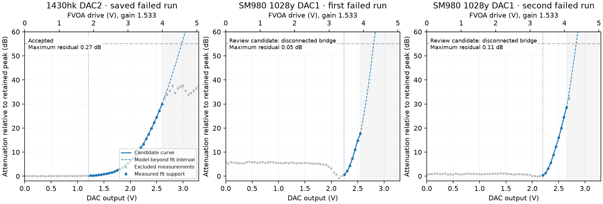

# Calibration closeout and commissioning evidence

Evidence reviewed: saved commissioning captures from 2026-10-28 through 2026-11-03 UTC,
older captures where explicitly identified, and the owner's 2026-11-02 external-meter
1028y characterization. This report separates archived observations from verification of
the closeout firmware. The latter is recorded at the end; an accepted numerical fit alone
is not a commissioning sign-off.

## What the existing data establish

The assembled system produces useful, repeatable characterization on several sources.
1430hk and 1430yj have especially consistent fitted power curves across repeated runs.
1028y and 1510h expose larger operating-condition dependence; 2330k has measurable upper-current
curvature and a substantial same-condition return change. These observations concern the whole
laser/FVOA/fiber/detector path. They do not isolate intrinsic laser noise or FVOA electrical noise.

A useful model and an automatic acceptance decision are different results. A valid candidate
that fails a repeatability or reference check should remain available for review, with its
usable current interval, residuals and original decision visible. A numerical failure supplies
no valid model to install. Noise, power-curve and route-loss adoption are separate decisions.

## Attenuator repeatability in practice

The comparison below uses raw, source-off-background-corrected, bridge-normalized sweep points
at matching DUT drive voltage. Both runs must classify the point as a fit candidate and place
it in the common 1–20 dB interval. Each entry is the RMS **difference across those matched voltage
points**, not temporal RMS and not uncertainty of a single fixed setting. DAC1 and DAC2 retain
separate references. No fitted polynomial is used to manufacture agreement between raw points.

| Source | Separation | DAC1 RMS difference (dB) | DAC2 RMS difference (dB) | Largest point difference, either DAC (dB) |
|---|---:|---:|---:|---:|
| 1028y | 4.2 h | 0.939 | 2.189 | 2.748 |
| 1270j | 4.2 h | 0.202 | 0.277 | 0.623 |
| 1430yj | 4.2 h | 0.269 | 0.297 | 0.605 |
| 1430hk | 6.5 min | 0.045 | 0.106 | 0.205 |
| 1510h | 6.5 min | 0.576 | 0.790 | 1.600 |
| 2330k | 6.5 min | 0.109 | 0.074 | 0.273 |

Capture pairs in `tools/commissioning_data/`, with the `cal_<source>_` prefix:

| Source | First capture | Second capture |
|---|---|---|
| 1028y | `20261030T231351_140878Z.pkl` | `20261031T032801_075500Z.pkl` |
| 1270j | `20261030T231552_566508Z.pkl` | `20261031T033001_743180Z.pkl` |
| 1430yj | `20261030T231753_971338Z.pkl` | `20261031T033202_644457Z.pkl` |
| 1430hk | `20261031T031324_648586Z.pkl` | `20261031T031955_062170Z.pkl` |
| 1510h | `20261031T031523_301321Z.pkl` | `20261031T032151_705934Z.pkl` |
| 2330k | `20261031T031719_911078Z.pkl` | `20261031T032348_338952Z.pkl` |

These are not controlled constant-configuration stability experiments. Accepted attenuator
acquisition changes the operational open voltages in RAM even with `persist=False`; the next
run may therefore use a different companion starting point. For the 1510h DAC2 comparison,
the companion starts near 1250 versus 1881 mV and the post-bridge companion is near 2275 versus
2591 mV. The reference signal changes from about 381 to 15.9 mV. The reported difference mixes
optical configuration, reference/bridge uncertainty, signal-to-noise and time. Old YJ captures
also include changed optics and an earlier SM980 FVOA; they must not be pooled as the same device.

All 26 pair captures reviewed from Oct28–31 completed acquisition. The ten pair captures carrying
`4a1107b` have accepted fits for all 20 physical sweeps. Earlier fit rejections remain useful raw
data. In particular, the first 2330k fit rejected at high drive is retained alongside the later
accepted runs; replay does not rewrite that decision.

The latest physical bridge counts (DAC1/DAC2) are 3/3 for 1028y, 2/2 for 1270j, 2/1 for 1430yj,
1/1 for 1510h and 0/0 for 1430hk and 2330k. There is no evidence of runaway bridging in these runs;
there is also no basis for claiming that every sweep requires at most two bridges.

### Measured support is not physical extinction

An HK fit reaching fewer measured dB does not establish a lower extinction ratio or higher
physical operating voltage. A weak source and detector background can stop useful measurement
well before the device's closed attenuation is reached. Fitted support, the 55 dB software
operating ceiling, the modeled continuation and FVOA drive voltage are distinct quantities.
The higher-drive behavior in the FVOA datasheet remains physical context; a detector-limited
run does not measure it. The plot therefore labels measured support and continuation separately
and retains the post-amplifier voltage axis. See [attenuator calibration](attenuator_calibration.md)
and the supplied [FVOA sheet](datasheets/FVOA_atten.pdf).

### What bridging assumes, and what has actually been tested

The current procedure fixes the source at 100% nominal output, holds a DUT voltage while changing
the companion, and uses the measured before/after signal ratio. It needs neither an accurate
companion model nor a linear laser L-I curve. It does assume that the companion ratio measured
at that DUT voltage applies to the subsequent segment, and that material path drift has not
occurred between the linked observations. Changing laser current during a sweep would introduce
an additional assumption and is deliberately avoided.

The external 1028y measurements show current/time-dependent loss, but do **not** independently
establish tandem interaction. Their six independent VOA configurations can be reproduced exactly
by six individual losses at each current, with positive monotonic losses under either assignment
of the unidentified single-10-dB device. A missing independent combination prevents a closure test.

An exact-DAC graph check of the 26 saved attenuator runs found no four-corner rectangles. Two
1510h runs do contain a six-edge cycle across their sequential DAC1/DAC2 sweeps:

| Capture | Closure error (dB) | Propagated window/background SE (dB) |
|---|---:|---:|
| `cal_1510h_20261028T004637_579151Z.pkl` | −1.870 | 0.149 |
| `cal_1510h_20261031T031523_301321Z.pkl` | −2.380 | 0.217 |

The six observations are DAC2 record 43, DAC1 records 25/27/44, and DAC2 records 28/30.
Requested voltages were rounded to the actual 12-bit DAC codes before matching; only unsaturated
records with corrected SNR at least five were used. Closure is the alternating sum of the six
`−10 log10(signal)` values. The quoted SE propagates window mean errors and the common background;
it excludes unmeasured temporal drift.

These cycles contradict one time-invariant separable surface over those observations. They do
not identify the cause: a global gain change of approximately 1.54× or 1.73× between the two
physical sweeps is mathematically confounded with interaction. The 1028 calibration captures
have no independent cycle. This evidence supports preserving measured first-usable bridging,
not reinstating old pre/post confirmation, DUT backoff, source-level ranging or model-derived
bridge ratios. It also prevents claiming that separability has been validated everywhere.

## Laser/path repeatability and model scope

The following comparisons evaluate archived candidate curves at identical currents with
`P(I)=(I−t)[η+q(I−I_e)]`. They are comparisons of fitted models, not absolute metrology or
fixed-current temporal stability. The percentage denominator is the first listed curve.

| Source and captures (`laser_cal_<source>_…`) | Compared range | Largest curve difference |
|---|---:|---:|
| 1430hk: `20261031T030044_091108Z`, `20261031T054425_817274Z` | 20–60 mA | 0.100% |
| 1430yj: `20261031T003909_267849Z`, `20261031T034631_422486Z` | 20–60 mA | 0.153% |
| 1270j: `20261031T002044_732415Z`, `20261031T034155_140178Z`, `20261031T060433_725407Z` | 20–65 mA | 3.542% total span |

The two 1430yj curves agree closely even though one run was rejected for a 6.31% identical-condition
return change. Both 1270j later candidates were rejected by the old dark-baseline consistency check;
that decision does not erase their useful shape information. The latest 1430hk run has 0.98% RMS
fit residual and 1.76% between-PD-level diagnostic disagreement. These are separate statistics.

The latest 1510h capture (`20261031T054846_323540Z`) has 22.55% RMS residual and an 88.66%
between-level diagnostic difference. It is not a marginal acceptance-boundary case. Its result
needs review as an assembled-path/model mismatch. The latest 2330k capture (`20261031T055355_284839Z`)
has 3.11% RMS residual but a 16.96% same-condition return change. A small within-window noise estimate
would not contradict such a larger change over the duration of a run.

The latest 1028y candidate (`20261031T055951_741481Z`) fits 103.7–250 mA with 2.92% RMS residual
but disagrees with the vendor characterization. The external-meter data provide valuable independent
context: fitting an ordinary straight line over 31.75–250 mA gives about 181.06 µW/mA, an extrapolated
zero at 16.02 mA and 2.58% maximum relative residual. This is an offline ordinary least-squares
comparison, not a reproduction of firmware GLS acceptance. The fitted zero is not the measured
physical knee near 12.2 mA. Real diode curvature remains visible and is not assigned to a software bug.

The external VOA paths change by approximately 0.88 dB (both at their minimum), 3.54 dB
(minimum/20 dB) and 2.36 dB (20 dB/minimum) over 24.5–250 mA. Fixed attenuation paths show much
less trend. Current and elapsed time were swept together, so the cause remains unresolved.
Within-current attenuator calibration can still work when transmission depends on current;
using that same transfer curve at a different current is the unvalidated extrapolation.

These numbers were independently recalculated from `laser_LI_direct.csv` and
`path_attenuation_vs_current.csv` supplied with the owner's 1028 characterization. Two corrections
to its narrative matter: the large compiled-profile error is near threshold (about 15.7× at
14.6 mA), not a persistent factor of two at 17 mA; and the quoted VOA1 14.9 dB is the *increment*
from its minimum to the 20-dB command, not its absolute loss at that command. Excess insertion
loss by itself does not prove an incorrect open-voltage reference. Reference planes, estimated
path losses and unidentified single-device measurements must remain explicit.

### Noise estimates and acceptance

Earlier firmware left constant/fractional noise unestimated after some fit rejections. That is a
software reporting limitation, not absence of measurements. The closeout separates estimation
from adoption: available noise information is reported even when a candidate requires human review.
A term can remain unidentifiable when the sampled power range is narrow or the two variance terms
are strongly correlated; that reason should be stated. Do not substitute zero for an unavailable
estimate, equate fitted residual RMS with temporal laser noise, or interpret a fitted path noise
term as proof of the physical source of variation. Historical archives retain their original
`not estimated` result rather than being silently rewritten.

## Dark-current closeout and operating guidance

Source-off measurements, closed-attenuator leakage and fitted baseline are different observations.
An attenuator driven closed does not establish a true dark. Same-run source-off measurements allow
baseline correction without overwriting the configured dark; residual changes still carry
uncertainty. Piecewise baseline knots account for the observed evolution rather than forcing all
three dark observations onto one straight line.

The owner's observed room-light sensitivity, early detector-on drift and possible post-saturation
persistence remain physical limitations. They are not established as a single mechanism by these
captures. Field scripts should power the detector, allow about half an hour before final dark and
precision measurements, and turn it off when finished. The configured long auto-off period is a
convenience, not a warmup test. Avoid intentional detector saturation; the usable raw ceiling is
2000 mV, distinct from ADC clipping at 2048 mV. If lighting, startup or saturation history changes,
review fresh source-off data instead of interpreting the resulting offset as optical throughput.

The optional slow autolevel response acts on sustained excursions outside the usable signal envelope.
Inside that envelope it issues **no current or attenuator writes**; it does not continually chase a
center setpoint. Saturation/no-signal handling remains prompt. Filtering can reduce unnecessary
actuator motion, but cannot repair an inaccurate denominator in reported throughput. The automatic
current interval is the reviewed model's useful interval. Manual engineering current access retains
the configured hard range and does not require changing the fitted threshold.

## Adoption and handoff

The commissioning notebook now previews the complete selected attenuator pair: coefficients,
uncertainty and both operational open voltages. RAM application/readback precedes a separate
persistence choice. Laser adoption includes all four curve coefficients and both automatic-current
bounds. Noise and complete outbound-loss totals have separate explicit writes/readbacks. Partial
errors are displayed and archived; no rollback or persistence-after-reboot is inferred from RAM
readback. The original acquisition's acceptance/application flags remain unchanged.

Current physical verification paths are YJ FEI → YJ SM return and HK FEI → HK MM return.
The two channels' capture selectors and plots remain independent. Replay is static; live widgets
are confined to live display cells. The historical 1028 manual-model experiment is retained but
disabled separately from the commissioning sequence. Raw archives are not rewritten or committed
as part of the software closeout.

## Closeout verification record

### Offline verification completed

- All 11 tracked notebooks' 291 code cells compiled after IPython transformation with top-level
  await support. Notebook checkpoint files were not treated as maintained sources.
- Latest saved laser captures for all six sources and five failed/accepted 2330 attenuator captures
  replayed without board requests. The 1028 review figure was rendered and visually inspected;
  its comparison panel contains the vendor, recorded current-settings and candidate curves.
- A temporary fake-client check applied a valid automatically rejected 1430yj candidate, including
  the upper automatic bound; applied/read back all six saved attenuator coefficient/open pairs;
  and confirmed that an injected open-setting write failure remains an explicit partial result.
- Repeatability and closure calculations above used temporary analysis scripts and existing data.
  No permanent test harness or new acquisition protocol was added.

### Build, OTA and board verification

The normal and timing MCUboot builds passed, using respectively 493,072/175,700 and
497,516/192,148 application FLASH/RAM bytes. The strict documentation build passed.
OTA installed firmware `a4a69d7001c4`, boot 29, on `hsfib-tib`. Confirmation was explicitly
requested after observing the fresh boot, exact image hash, readiness and bank-off state:
`8b87a9e816faddf43bbf93b10caaad531a9a3d4067d9e122e0e86cd2e71ee0b6`.
The subsequent notebook-only follow-up `34f9f0a` does not change that flashed firmware.

Four existing firmware calibration flows completed on 2026-11-03 UTC without overflow or reset, using
the existing `hk_fei → hk_mm` and `yj_fei → yj_sm` loopbacks. Laser acquisition used 1000 ms
windows and 2000 ms settling; attenuator acquisition used 550 ms windows. No laser model,
noise or route loss was applied, and nothing was persisted. The attenuator flow's accepted
coefficients and operational opens were installed in RAM by the normal flow, then the
pre-run pair was restored and verified.

| Run | Retained records | Selected support | Fit RMS | Maximum residual | Decision |
|---|---:|---|---|---|---|
| 2330k attenuator | 136 (68 per DAC) | 44/42 points; 29.07/28.37 dB | 0.0880/0.1003 dB | 0.2003/0.2121 dB | Both accepted; zero bridges |
| 1430hk laser | 171 | 94 windows; 5.3–60 mA | 0.7161% | 2.2094% | Accepted |
| 1270j laser | 191 | 94 windows; 9.8–65 mA | 2.4084% | 6.1194% | Accepted |
| 1430yj laser | 185 | 96 windows; 6–60 mA | 1.2672% | 5.8985% | Accepted |

Laser maximum residuals are raw percentages; acceptance includes the documented three-measured-SE
allowance beyond 5%. Every accepted laser interval reaches its configured sweep maximum.
The previously overflowing 1430hk flow completed in 171 records. Local raw captures are in
`tools/commissioning_data/`:

- `cal_2330k_20261103T041850_711129Z_closeout.pkl`
- `laser_cal_1430hk_20261103T042048_042217Z_closeout.pkl`
- `laser_cal_1270j_20261103T042500_921024Z_closeout.pkl`
- `laser_cal_1430yj_20261103T042935_882896Z_closeout.pkl`

The new laser runs preserve useful variation diagnostics despite their accepted decisions:

| Laser | Constant noise (mW) | Fractional noise | Repeated-condition change | PD-band disagreement |
|---|---:|---:|---:|---:|
| 1430hk | 0 | 0.8932% | Not estimated | 1.1384% |
| 1270j | 0 | 4.2050% | 4.7452% | 8.0991% |
| 1430yj | 0.003179 | 1.6893% | 5.8568% | 7.5321% |

These are the firmware's conditional diagnostics and effective noise estimates. They do not
isolate intrinsic diode noise, and zero fitted constant noise is a constrained estimate.
The separate unadjusted same-current plots still expose differences among DAC pairs.
The archived HK diagnostic reports zero, but inspection found no eligible illuminated revisit:
its only exact repeat was at 1.8 mA, with both conditions classified below SNR. Zero therefore
did not measure perfect repeatability. The final reporting fix emits an unavailable fraction
when no eligible comparison exists; it does not change fitting or acceptance.

Both YJ runs used a configured dark of −2.27656 mV. The three same-run source-off observations
show why that single value is insufficient throughout a capture. Here raw means add the
configured dark back to the two late windows' recorded mean; fitted offsets are relative to
that configured dark, not absolute ADC readings:

| Laser | Dark-condition times (s) | Observed raw dark means (mV) | Fitted offset knots (mV) |
|---|---|---|---|
| 1270j | 6.810 / 146.797 / 270.167 | −2.27656 / −2.16562 / −0.89531 | +0.05447 / +0.06355 / +1.34409 |
| 1430yj | 6.791 / 143.475 / 264.543 | −2.15625 / −2.04375 / −2.12656 | +0.19132 / +0.28489 / +0.15123 |

Observed dark spans are 1.38125 mV and 0.11250 mV, respectively. Maximum observed-versus-fitted
dark differences are 0.05447 and 0.07101 mV. The piecewise baseline represents these observations;
this short post-OTA sequence neither establishes their physical cause nor validates half-hour
warmup or long-duration dark stability.

After the calibration sequence, independent readbacks found all six sources stopped, all
attenuator DACs closed, and all original laser policies, coefficients and operational opens
matching the pre-update snapshot; boot count remained 29. The new automatic upper bounds
initialized to nominal current. Reboot did not retain the snapshot's 1028y threshold or
operational-open pairs; those values were restored in RAM before acquisition, without persistence.

All four fresh captures replayed through the commissioning review functions. Rendered figures
were inspected; source identities, selected support and integer-midpoint baseline knots agree
with the metadata. The new 1430hk candidate differs by at most 0.05414% from the latest October
31 candidate over 20–60 mA, using the older curve as denominator. This comparison spans both
new measurements and the baseline-model revision. Notebook follow-up fixes preserve stored
outputs, show missing optional context explicitly, and distinguish installed automatic bounds
from candidate support and engineering limits.

### Current commands, autolevel and shutdown ownership

Both 1430 sources accepted engineering current below the automatic minimum and at the 60 mA
engineering maximum while the automatic ceiling was temporarily 36.7 mA. Negative/over-limit
current and incompatible drive/STOP requests were rejected by firmware. A 0.04 mA request
rounded to zero while preserving the existing deadline; an explicit three-second deadline
stopped the source. These checks used closed attenuators and RAM-only policy changes.

Four 15-second holds retained 299–300 samples each, with feedback active, no overrange samples,
no observed current/DAC setpoint transitions and no sample gap above 51 ms:

| Path and mode | Net PD range (mV) | Median (mV) | Initial condition |
|---|---:|---:|---|
| 1430yj, existing band | 471.78–547.78 | 525.84 | Entered startup band |
| 1430yj, quiet 0.1 Hz | 507.96–561.71 | 539.59 | Entered startup band |
| 1430hk, existing band | 335.86–349.17 | 342.17 | Reached available-flux limit |
| 1430hk, quiet 0.1 Hz | 338.48–348.55 | 342.48 | Reached available-flux limit |

The first HK verification attempt expected the 400–1600 mV startup band and failed that
assumption: the source was already at its 49 mA automatic ceiling with both DACs at operational
open. The revised check explicitly recognized useful signal at those limits. No control change
was needed. Same-setting requests are suppressed by the existing current quantizer and
attenuator epsilon checks. These captures observe setpoints, not individual bus transactions.
YJ quiet mode left a useful signal near 540 mV alone instead of steering toward 1000 mV.

On both channels, a manual current command disabled feedback but retained streaming and source
shutdown on measurement STOP. A noise-policy edit retained streaming and the original measurement
deadline; expiry stopped the source. Settings were restored and cleanup readbacks passed. Local
reports are `controls_20261103T043424_252367Z_closeout.json` (engineering checks, YJ and the initial
HK limit observation) and `controls_20261103T044120_963153Z_closeout.json` (completed HK checks).
The associated raw throughput captures are saved beside them.

Temporary tests of the actual C control functions also covered useful-signal ramps/steps at
0.1/0.5 Hz, noise-floor excursions, raw saturation, actuator limits and shutdown ownership.
The useful-signal cases issued zero setter calls. Those simulated excursions were not reproduced
as physical external-system sweeps, and detector saturation was not deliberately induced.

### Bounded tandem check and throughput normalization

Three temporary 1430yj investigations are retained. The first stopped because one device was
on its open plateau. The second completed but its first-axis effect was unresolved; its small
closure is not evidence for separability. Their files are
`tandem_1430yj_20261103T043716_618437Z_closeout.json` and
`tandem_1430yj_20261103T043853_615499Z_closeout.json`.

The final bounded probe, `tandem_1430yj_20261103T044318_855134Z_closeout.json`, used fixed
approximately 80 mV changes on each axis. Exact 12-bit code corners were A=(2566,2668),
B=(2665,2668), C=(2665,2767), D=(2566,2767). Both axes were resolved: the first changed loss
by 0.32–0.49 dB, the second by 2.77–2.86 dB. At each fixed current the sequence was
A–B–C–D–A–D–C–B–A, with source-off measurements bracketing the experiment and a final return
to the original current. All main-sequence net signals were approximately 61–208 mV.

Closure is `10 log10(S_A S_C / (S_B S_D))`, using dark-corrected window means. The quoted
conditional SE propagates within-window scatter, paired-window variation and shared measured
dark uncertainty; it excludes unobserved path changes between holds. Public PD windows expose
no firmware endpoint timestamp, so approximate host times and timing uncertainty are retained.
Codes were reconstructed and checked against confirmed mV and the 3.3 V, 12-bit DAC transfer.

| Current | Forward/reverse mean closure (dB) | Conditional SE (dB) |
|---|---:|---:|
| 28.5 mA | −0.0981 | 0.0525 |
| 19.9 mA | −0.0750 | 0.0567 |
| Difference between currents | +0.0231 | 0.0773 |

This is a useful local bound, not proof of perfect separability. Small, approximately 2%
nonclosure remains possible. It does not explain or erase the earlier 1.9–2.4 dB six-edge
results on another source. Repeated corners changed by roughly 0.06–0.16 dB, and the final
original-current A return changed −0.118 dB (−2.68%). During the initial A–B–A pilot, signal
fell approximately 31% despite unchanged reported current (28.5 mA) and temperature (24.97°C).
The 0.14 mV change between bracket darks cannot explain that optical-sized change. Source,
FVOA, coupling and detector history remain possible contributors. No time correction or
new bridge policy was introduced to conceal this behavior.

The same raw measurements directly test the motivation for laser calibration. For identical
DAC settings, recompute the throughput change between currents by dividing the measured
signal ratio by the model's source-power ratio. Across the four corners:

| Denominator | Predicted P(19.9)/P(28.5) | Apparent throughput change | Conditional SE |
|---|---:|---:|---:|
| Pre-existing active linear model, threshold 8.0 mA | 0.58049 | +9.43% | 0.49 percentage points |
| Fresh candidate, threshold 4.2705 mA | 0.64506 | −1.52% | 0.44 percentage points |

The measured geometric-mean signal ratio was about 0.63525. Efficiency cancels in these linear
ratios: correcting the fitted threshold is what removes most of the artificial current
dependence here. Individual candidate residual changes were −2.53% to −0.40%, comparable to
the observed return drift. The earlier weak-axis experiment independently gave +9.87% versus
−1.13%. This is offline substitution of the saved candidate into the denominator; the model
was not installed. It supports improved relative normalization at these two currents, not
absolute vendor power accuracy or every current/attenuator configuration.

Final independent readback after these investigations again confirmed all six sources stopped,
all DACs closed, original laser policies/coefficient/open pairs restored, the image confirmed,
and boot count unchanged at 29. No experimental settings were persisted.

### Final image and reporting correction

After the bench investigations, `eebba1b` changed only the unavailable repeat-fraction diagnostic
to NaN. Actual-C replay of all three fresh laser captures preserved all 16 checked fit,
acceptance and noise outputs and error strings. HK became unavailable, both YJ repeat values
were unchanged, and a synthetic eligible identical repeat remained exactly zero. Actual C
encoding and Python decoding of the 634-byte HK metadata preserved NaN; the notebook displays
it as “Not estimated.” Acquisition and acceptance policy did not change.

Final firmware `dfb0a000a1f4` was OTA-flashed and explicitly confirmed at boot 30 with hash
`f9a09c38975d2e9179bc2941c2c7841ae0a4860e51b204328c38d527a976ab33`, after exact-hash,
fresh-boot, board-ready and bank-off checks. UDP upload timeouts recovered by resuming the
upload; complete image verification and the final confirmation readback succeeded. The normal
and timing MCUboot builds passed at 493,080/175,700 and 497,524/192,148 FLASH/RAM bytes.
The timing build retained its expected assertions-enabled warning; no new source warnings arose.
The four optical calibrations and control/corner measurements above ran on `a4a69d7001c4`;
they were not repeated for this diagnostic-only correction.

After the final reboot, snapshot RAM values were restored again. Independent queries confirmed
all six sources stopped, all attenuators closed, original laser policies/coefficients/opens
restored, and OTA confirmed with its maintenance window closed. PDs were left powered in their
existing ten-hour auto mode; this reboot restarted their powered age. All 11 tracked notebooks'
291 code cells compiled, fresh captures replayed, and the strict Sphinx build passed.

These short checks do not establish long-term optical stability, absolute power accuracy, the
OTA power-cut/rollback matrix or full fault recovery. Final full YJ/HK commissioning and owner
sign-off remain separate.

## November 3 attenuator follow-up

The fresh failures had more than one cause. The 1430hk DAC2 failure after repeating the dark
was driven by high-drive, near-background points becoming statistically eligible: their inclusion
pulled the curve away from its well-measured closing response. The 55 dB ceiling could not help
because this weak path flattened near 35–40 measured dB. The two new SM980 1028y pair captures
completed acquisition but lost normalization at bridges that had passed the acquisition's raw
SNR check and failed the final background-corrected check. Their later segments still contained
useful data. A nine-point reference window also treated a narrow optical peak as noise, and the
optimizer's `8/span` initial slope assumed a wider response interval than these data supplied.

The fixes address those distinct mechanisms. Acquisition retains fixed laser current and the
closed-to-open grid, accepts the first measured reduction with sufficient ratio precision, and
uses the already measured source-off background. Postprocessing selects one contiguous measured
closing interval before fitting: low-drive brightening and high-drive flattening bound it,
independently of how many dB the detector can resolve. Reference selection uses three contiguous
readings and measured errors; fitting starts from a five-point slope near half transmission
at one companion setting. The fresh 1430yj run exposed why a two-point slope spanning a bridge
is unsuitable: a small segment offset gave the optimizer an almost flat starting gradient.
The final initializer reuses the same within-segment slope calculation as interval selection.
The minimum support, residual, monotonicity and 55 dB checks remain. There is no repeated trimming
until a fit passes. A broken bridge can now leave a valid review candidate from the connected
open-side measurements, but prevents automatic adoption. See the
[algorithm and uncertainty definitions](attenuator_calibration.md).

This figure replays the actual C fit on saved measurements; it is not new acquisition and does
not rewrite the original decisions. Blue points belong to the selected interval, grey points
are excluded, purple marks operational open, and the dashed curve is outside fitted support.
The two SM980 panels are different runs of the newly installed pair, not the older SM28 devices.
Their markedly different low-drive shapes remain visible; a good restricted fit does not make
that operating-condition dependence disappear.

**Hardware qualification:** during this investigation the owner reported that YJ physical
attenuator 2 in this SM980 pair was labeled for suspicious physical behavior and may be partly
or fully faulty. All new 1028y sweeps, companion checks and control checks below concern this
particular suspect pair. They are not evidence of normal SM980 device behavior, and a fault
in DAC2 can affect a sweep of DAC1 when DAC2 serves as its companion. Recheck with a known-good
pair before drawing general conclusions or treating these models as a hardware reference.

### Offline scope and limits

Actual-C replay of 88 physical reverse-sweep datasets preserved all 70 previously accepted fits.
The revised result is 77 automatically accepted, five numerically valid candidates requiring
review, and six without a valid model. All four failed new-SM980 sweeps now yield review candidates
with 7–15 points and maximum residuals 0.05–0.41 dB; their broken links remain explicitly rejected.
An older 1510h candidate still exceeds the 2 dB residual threshold. Thirty-two ideal broad/narrow
response checks span source brightness and background offsets. Sixteen complete synthetic
acquisitions compared old/new bridging across four brightness levels and two backgrounds: bridge
counts stayed identical (0, 0, 2 or 4 per physical device), with no overflow. These are bounded
checks, not a claim that real optical changes cannot increase bridge count. Another 28 synthetic
fits with ±0.9 dB segment offsets around half transmission passed after the initializer correction;
that check exercises a source of bad initialization, not a guarantee of tandem separability.

The older forward sweeps were also considered. A response-only replay normalized their retained
measured links into one numerical segment before running the current interval selection and fit;
it does not reconstruct missing old dark measurements or test reverse acquisition. Seven of eight
physical responses yielded accepted candidates, including both Sept17 pre-55-dB 1028y responses
and both Oct27 1430hk/2330k responses. Oct27 1510h DAC1 lacked a usable peak/crossing. The Sept17
1028y DAC1 support ends at 2750 mV DAC, before the conspicuous high-drive reversals above 3000 mV.
The source is `tests/throughput/calibration_replay.npz`; the older HK files are
`cal_1430hk_20261027T181356_402723Z.pkl`, `cal_1510h_20261027T181609_840884Z.pkl`, and
`cal_2330k_20261027T181823_197469Z.pkl` in `tools/commissioning_data/`.

The host normalization/plot checks covered 112 saved pair captures, including the new bench data.
Positive low-SNR points can
be displayed without entering fitting support. Missing global normalization now produces labeled
within-segment diagnostic curves. Commissioning cell sources compile, raw records remain unchanged,
and original notebook outputs are preserved; rerun the helper-definition cell to use the new plots.
Final actual-C replay including the ten fresh pair captures covers 108 physical sweeps:
97 accepted, five valid review candidates and six invalid. All 89 originally accepted results
in that combined set remain accepted. These counts include fresh acquisition as additional data;
they do not replace the separate 88-sweep historical comparison above.

### Voltage range and interpretation

The supplied FVOA sheet describes a typical SM28 voltage response and a much higher physical
extinction than these weak HK measurements resolve. Its typical full-range drive is not an
independent per-unit voltage calibration. The 55 dB software ceiling was intended to avoid the
poorly behaved closing region, so it cannot be the only exclusion rule when the detector runs
out of useful signal first. Conversely, a short measured interval is not evidence of low physical
extinction. These fits retain the separate leakage constraint and label continuation explicitly.

The stored drive gain is 1.533, while the recorded schematic resistor ratio gives about 1.517;
that roughly 1% difference cannot explain a volt-scale apparent shift. Raw HK responses, companion
settings, background and sweep history must be distinguished from a model distorted by tail points.
The following checks use unchanged hardware/patching and fixed current to test those conditions.

### Fresh sweeps and short-term repeatability

Nine standard attenuator runs completed on `01e0c4935545-dirty`, boot 37, using 550 ms windows
and the existing FEI loopbacks. This firmware includes the bridge/background and interval fixes;
the final initializer correction followed the one failure below. Every acquisition completed,
with no record overflow, reset or cleanup error. Accepted coefficients/opens were installed by
the normal flow in RAM, then restored to the pre-run snapshot before each subsequent run.
Nothing from these calibrations was persisted.

| Laser / pair | Records, both DACs | Bridges, DAC1 / DAC2 | Last included DAC voltage (mV) | Maximum residual (dB), DAC1 / DAC2 |
|---|---:|---|---|---|
| 1430hk | 136 | 0 / 0 | 2650 / 2550 | 0.172 / 0.290; accepted |
| 1510h | 139 | 1 / 1 | 2600 / 2700 | 0.673 / 1.182; accepted |
| 2330k | 136 | 0 / 0 | 3150 / 2850 | 0.161 / 0.203; accepted |
| 1028y, new SM980 | 156 | 4 / 4 | 2900 / 2850 | 0.130 / 0.593; accepted |
| 1270j | 147 | 2 / 3 | 2700 / 2650 | 0.747 / 0.411; accepted |
| 1430yj | 143 | 2 / 2 | 2850 / 2950 | 18.278, review / 0.409, accepted |
| 1430hk repeat | 136 | 0 / 0 | 2700 / 2600 | 0.153 / 0.285; accepted |
| 1510h repeat | 139 | 1 / 1 | 2650 / 2750 | 0.439 / 0.812; accepted |
| 1028y SM980 repeat | 156 | 4 / 4 | 2900 / 2850 | 0.273 / 0.568; accepted |

Actual-C replay of the failed fresh 1430yj DAC1 with the corrected initializer accepts the same
support at 0.836 dB maximum residual. No acceptance threshold, support selection or model weight
was changed to obtain that result. All other accepted fresh results remain accepted in replay.
The final-image board rerun is recorded below.

The four SM980 bridges per device repeat consistently. This is one or two more than the old
failed SM980 captures, whose weak bridges are the reason normalization failed. The new captures
contain 156 records versus 146/150 previously; they do not show repeated runaway bridging.
They demonstrate the cost of a usable bridge margin on this bright pair, not a universal bound
of two bridges. The other five sources needed zero to three bridges per device.

The following comparison matches actual DUT voltage, companion voltage and laser percentage
between the first and repeated runs, using points in both measured supports and 1–20 dB.
“Shape RMS” removes the median raw signal change; “reference RMS” retains changes relative to
each run's selected reference. These include the complete illuminated path and acquisition
history. They are not intrinsic FVOA noise specifications.

| Pair / device | Matched points | Median raw signal change (dB) | Shape RMS (dB) | Reference RMS / maximum difference (dB) |
|---|---:|---:|---:|---|
| 1430hk DAC1 | 15 | −0.058 | 0.033 | 0.095 / 0.139 |
| 1430hk DAC2 | 18 | +0.015 | 0.045 | 0.045 / 0.110 |
| 1510h DAC1 | 10 | +0.035 | 0.518 | 0.544 / 1.282 |
| 1510h DAC2 | 16 | −0.151 | 0.353 | 0.394 / 0.830 |
| 1028y SM980 DAC1 | 6 | +0.179 | 0.116 | 0.237 / 0.387 |
| 1028y SM980 DAC2 | 9 | −0.019 | 0.159 | 0.139 / 0.341 |

Captures are `cal_<laser>_<UTC>_closeout_nov3.pkl` in `tools/commissioning_data/`, starting at
`20261103T215324_573429Z` and ending at `20261103T220923_308334Z`. The SM980 identity is recorded
in their patch notes; the later owner qualification is retained in
`1028y_SM980_hardware_note_20261103.json`. Earlier 1028y SM28 data must not be pooled with this pair.

### Companion dependence and time dependence

The suspect DAC2 qualification above applies to every 1028y result in this section.

At fixed 250 mA on 1028y, a temporary A–B–B–A check compared companion DAC settings 2915.7 and
3011.8 mV while holding the swept device at several voltages. The bracketed source-off means
were −1.872 and −1.759 mV. Both devices' 2500 mV measurements were too weak for the comparison
and are retained but excluded from the table. A preceding attempt at 2787.6 mV clipped the PD;
its guard stopped the probe, retained the failed capture and closed the attenuators. The dimmer
settings below came from the new sweep, without changing laser current during either check.

| Held DUT voltage (mV) | Apparent companion effect, DUT DAC1 (dB) | Same-setting A return change, DAC1 (dB) | Apparent companion effect, DUT DAC2 (dB) |
|---:|---:|---:|---:|
| 2300 | −0.177 | +0.942 | 8.567 |
| 2150 | 2.460 | +3.071 | 8.144 |
| 2050 | 5.526 | +1.631 | 8.020 |
| 1800 | 7.609 | +0.782 | 7.861 |

These are geometric-mean ratios after bracketed background subtraction. DAC1's large return
changes prevent assigning its changing ratio solely to a static tandem interaction. DAC2 is
steadier, but its 0.706 dB ratio span still exceeds its 0.014–0.187 dB A-return changes. The data
do not support treating arbitrary tandem changes as exactly additive dB in this configuration.
They also do not identify which optical component or mechanical effect causes the variation.

The shaded ranges in the upper panels span the retained A/B return ratios; they are not
confidence intervals. The lower panels show separate holds from the follow-up check.

A follow-up held the DUT at 2050 mV and retained about 13 seconds at each A, B and returned A
setting, still at 250 mA. Raw signal changed from 200.3 to 178.6 mV on the first DAC1 A hold,
and from 248.9 to 211.2 mV on the first DAC2 A hold. Returned A holds also changed with time.
This is direct evidence that one short dwell is not a settled, history-independent response
at every combination. It is not a measured settling-time requirement: the short records show
continuing fluctuations and do not establish an asymptotic value. No new hold was added to
calibration or throughput firmware.

For 1430hk at fixed 49 mA, changing the companion from 0 to 1250 mV caused about 0.224–0.287 dB
additional loss with DUT DAC1 and 0.050–0.084 dB with DUT DAC2 over 1000–2300 mV. The 2600 mV
points approach background and are poor evidence for a small ratio. This check does not show
a companion-induced voltage shift large enough to explain the original fit distortion.

Raw checks are `companion_1028y_20261103T221705_176024Z_closeout_nov3.json`,
`companion_1430hk_20261103T221826_579308Z_closeout_nov3.json` and
`companion_settling_1028y_20261103T221956_052939Z_closeout_nov3.json`, with their passive stream
captures beside them. The aborted clip is retained as `companion_1028y_20261103T221604_582543Z_closeout_nov3.json`.

### Photodiode restart verification

The small power-state change stores successful PD relay state separately from dark/calibration
settings. Saved overrides take precedence; AUTO restores the last state, with a fresh countdown
and powered age. Early driver initialization may interrupt power, so this is not uninterrupted
warmup across an MCU restart. Ordinary reboot now preserves that intent instead of explicitly
switching both PDs off before restarting. Returning from a powered override to AUTO rearms its
deadline. An offline relay command returns an error rather than pretending to succeed.

Three board reboots verified AUTO on/off restoration in both combinations, saved-override
precedence against deliberately opposite RAM state, and expiry of a restored 15-second AUTO
timer without a PD query to rearm it. Original AUTO/36000-second policies were restored and
verified. Temporary checks of the actual settings functions covered missing records, duplicate
writes and failed NVS writes with subsequent retry. A relay failure was not physically induced.
Existing warmup, lighting and saturation guidance remains; no new dark-recovery sequence or
mandatory hold was added.

### Final image and targeted rerun

Normal and timing MCUboot builds passed at respectively 495,608/175,700 and
500,052/192,148 application FLASH/RAM bytes, without new source warnings. The timing build
retains its expected assertions-enabled warning. Final firmware `d43936221d13-dirty` was
OTA-installed and explicitly confirmed at boot 38 with image hash
`59dfd267c4e20ac3573ed7bc668a7559e212cee4924d8df107146e3b5b584e14`.
Confirmation followed exact built-image hash, fresh-boot, board-ready, healthy relay and
bank-off checks; its reason was printed explicitly. The dirty suffix includes the owner's
uncommitted notebook/review material, not an uncommitted firmware change. Subsequent report
and guidance edits do not change this image.

The fresh 1430yj standard attenuator rerun on that image accepted both devices at
0.960/0.421 dB maximum residual, with 34 fitted points each and two bridges per device.
Acquisition retained 143 records without overflow/reset, and shutdown and original-setting
readbacks passed. Its file is `cal_1430yj_20261103T222258_352281Z_closeout_nov3.pkl`.
The other six-source and repeat checks above ran before this initializer-only correction;
their captures were replayed through the final C fitter rather than reacquired unnecessarily.

### Laser fit and relative-throughput check with fresh attenuator models

The first 1430hk laser run used the owner's pre-run attenuator models and retained 168 records.
Its 5.3–60 mA candidate was valid, with 0.844% RMS and 2.558% maximum residual, but requested
review for a changed repeat. That comparison was at 1.8 mA, below the fitted emitting interval:
baseline-corrected means were +0.0245 and −0.0258 mV. Their 0.0503 mV difference narrowly exceeds
the repeat test's approximately 0.0442 mV allowance. Neither is an eligible illuminated ratio,
so `revisit_fraction` is correctly unavailable, not zero. This decision does not mean the
well-illuminated power curve failed to fit. Fractional effective noise was still estimated
at 0.949%, with its constrained constant component at zero.

After installing the accepted fresh 1430hk attenuator models in RAM, the final-image laser run
completed in 170 records and accepted 5.3–60 mA with 94 fitted windows, 0.710% RMS and 1.782%
maximum residual. Threshold was 3.9741 mA and efficiency 0.222094 mW/mA, with no quadratic term.
Fractional effective noise was 0.945%; constant noise again fitted zero. Maximum fitted-versus-
observed dark discrepancy was 0.157 mV and remains a visible diagnostic. Both runs' candidate
curves differ by at most 0.050% over 20–60 mA despite the different acceptance labels.
Both saved captures replayed through the commissioning review functions and their plots were
rendered and inspected. Neither laser flow applied or persisted curve, noise or route-loss settings.

The second capture is `laser_cal_1430hk_20261103T222532_443773Z_with_new_atten.pkl`; the first is
`laser_cal_1430hk_20261103T221130_635510Z_closeout_nov3.pkl`. Their source-off observations are
short same-run constraints. They do not establish long-term dark stability or separate room
light, powered age and illumination history.

The accepted candidate and fresh HK attenuator models were then installed temporarily in RAM
for a fixed-DAC 40 → 20 → 40 mA comparison. Each DAC pair had source-off observations before
and after; the mean of that bracket was subtracted. The middle reading is compared with the
geometric mean of the two 40 mA returns. No FVOA moved during each current sequence.

| Requested DAC losses | Observed 20/40 mA signal ratio | Apparent throughput change with original laser model | With installed candidate | 40 mA return change |
|---|---:|---:|---:|---:|
| 3 + 3 dB | 0.45076 | +14.42% | +1.33% | +1.38% |
| 8 + 3 dB | 0.44979 | +14.18% | +1.11% | −1.15% |

The candidate reduces current-dependent normalization error to about the observed return
variation in these checks. This directly addresses relative-throughput discontinuity when
source current changes. It does not prove absolute optical power or normalization across
arbitrary tandem changes. No laser noise or route-loss values were adopted.

Each autolevel check then allowed 25 seconds for startup and retained the following 35-second
hold. These are temporary verification intervals, not new operational dwell requirements.

| Path / feedback mode | Samples in hold | Mean net PD (mV) | Temporal RMS (mV) | Maximum raw PD (mV) | Current/DAC setpoint changes |
|---|---:|---:|---:|---:|---:|
| 1430hk, existing band | 700 | 431.10 | 3.56 | 445.25 | 0 |
| 1430hk, quiet 0.1 Hz | 700 | 428.60 | 3.51 | 444.06 | 0 |
| 1028y suspect pair, existing band | 699 | 575.82 | 10.26 | 597.25 | 0 |
| 1028y suspect pair, quiet 0.1 Hz | 699 | 486.06 | 5.61 | 498.81 | 0 |

Feedback remained active in every retained hold. All four complete streams, including startup,
stayed below saturation and had no sample gap above 51 ms. HK reached its available-flux limit
at 60 mA and the calibrated operational opens. Both YJ holds used 132.3 mA and the same
2574.10/2541.87 mV DAC pair; the differing signal levels across restarts therefore do not come
from observed setpoint movement. The suspect hardware and optical history remain confounders.
These tests demonstrate quiet control in these configurations, not stability of the suspect
pair or performance throughout an external instrument sweep. Useful signal was left alone;
there was no steering back toward 1000 mV during the holds.

The current-return and autolevel record is
`candidate_controls_20261103T223025_397550Z_closeout_nov3.json`, with its named raw throughput
captures beside it. `atten_closeout_verification_20261103.json` collects the pre-run snapshot,
PD restart checks, explicit OTA confirmation, numerical comparisons and final readback.
Final independent readback at boot 38 verified the original laser policies,
all six attenuator coefficient/open pairs and MEMS positions, all sources stopped and all DACs
closed. Original PD power intent was restored: YJ on, HK off, both AUTO with 36000-second timeouts.
Fresh measured darks remain in RAM; no experimental calibration, noise or loss was persisted.
The exact final image remains confirmed with no pending image and the OTA window closed.

The implementation, targeted hardware verification, saved-data review and documentation
reconciliation are complete for this revision. Full owner commissioning, long-term stability,
independent absolute power, a known-good SM980 comparison and the broader fault/rollback matrix
are not established by these checks. Existing notebook experiment choices and saved outputs
were preserved; no permanent test infrastructure or mandatory lab sequence was introduced.
