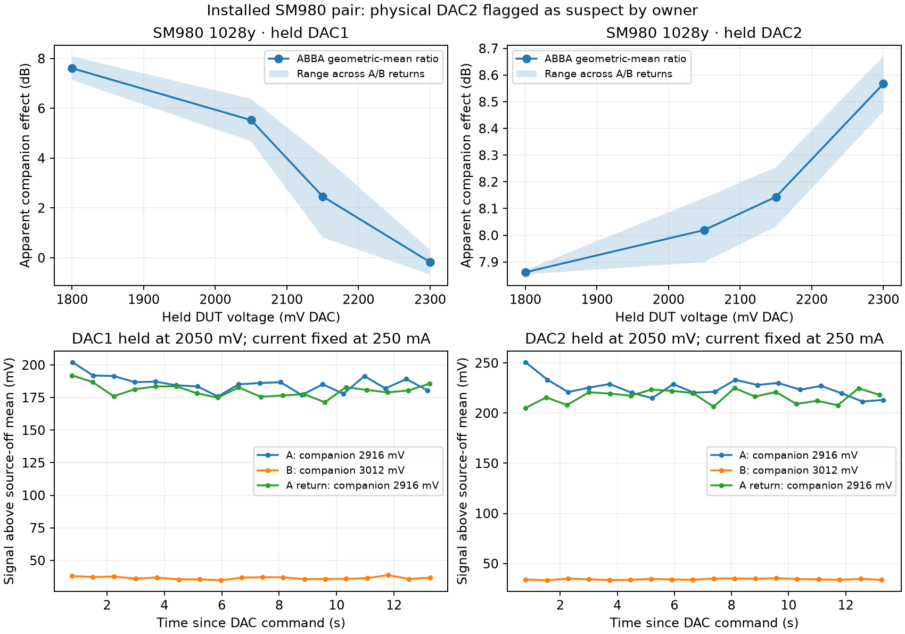

# Calibration closeout and commissioning evidence

This report covers saved measurements from October 28 through November 4, 2026 UTC,
older responses where identified, and the owner's external-meter characterization.
It describes an embedded controller, its demonstration Python helper, and example
analysis notebooks. It does not prescribe an AIT workflow for the larger instrument.

## Conclusions and model scope

Useful laser and attenuator models coexist with substantial optical-path variability.
The variation spans measurement windows, returns to the same settings, and separate
runs. It is correlated and not well described by a single Gaussian noise parameter.
A quiet one-second window does not establish the precision of a later visit.

The clearest recent example is 1028y at **27.3 mA**, with the exact same DAC codes
**3166 / 3125**: corrected PD readings were **150.19 and 102.44 mV**, separated by
**109.6 seconds**, an observed **31.8% difference** using the observed-dark baseline.
Neither was near darkness or saturation. This describes that current and DAC
pair, not every operating point. Its relevance to an intended measurement also
depends on the attenuator voltages and measured response there. It is not
evidence of an operator error, a Gaussian sigma, or a measured upper bound on
future variation.

Firmware estimates a central response within that variability. Acquisition completion,
model availability, automatic acceptance, application and persistence are separate
results. A review candidate can be useful without qualifying for automatic installation.
Raw observations remain available. Numerical acceptance is not physical commissioning.

The laser fit profiles one gain per exact DAC pair over the entire capture. That
removes reliance on accurately summing two individual FVOA calibrations, but a
constant pair gain cannot remove current-dependent optical-path distortion.
The current revision therefore estimates threshold from the lowest informative
local windows, anchors power to the configured reference, and takes required
curvature from the vendor trace. The broad acquisition tests that proposal and
describes path variation; it does not steer source curvature to fit FVOA physics.
Independent high/low-band comparison uses raw signal-ratio shapes, so a shared
vendor prior cannot manufacture their agreement. This improves the basis for
relative-throughput tracking without claiming independent absolute radiometry.

## Attenuator repeatability in practice

The following short-term comparisons match actual DUT voltage, companion voltage and
laser percentage in both runs' measured 1–20 dB regions. Shape RMS removes the median
raw signal difference. Reference RMS retains each run's selected normalization. These
are descriptive differences across matched points, not temporal noise specifications.

| Pair / physical FVOA | Matched points | Median signal difference (dB) | Shape RMS (dB) | Reference RMS / largest difference (dB) |
|---|---:|---:|---:|---:|
| 1430hk DAC1 | 15 | −0.058 | 0.033 | 0.095 / 0.139 |
| 1430hk DAC2 | 18 | +0.015 | 0.045 | 0.045 / 0.110 |
| 1510h DAC1 | 10 | +0.035 | 0.518 | 0.544 / 1.282 |
| 1510h DAC2 | 16 | −0.151 | 0.353 | 0.394 / 0.830 |
| 1028y SM980 DAC1 | 6 | +0.179 | 0.116 | 0.237 / 0.387 |
| 1028y SM980 DAC2 | 9 | −0.019 | 0.159 | 0.139 / 0.341 |

These are the November 3 captures ending `_closeout_nov3.pkl`, from
`20261103T215324_573429Z` through `20261103T220923_308334Z` in
`tools/commissioning_data/`. Earlier 1028y SM28 measurements must not be pooled
with the replacement SM980 pair. The owner identified **SM980 physical 2 as a
suspect device**; its behavior can affect a sweep of physical 1 as its companion.
These measurements do not qualify SM980 FVOAs generally.

The older October 30–31 comparisons, separated by approximately 4.2 hours on YJ,
gave reference-relative RMS differences of 0.202/0.277 dB for 1270j and
0.269/0.297 dB for 1430yj. The earlier 1028y pair gave 0.939/2.189 dB. Companion
settings and references can differ between runs, so these are repeatability of
the complete characterization, not fixed-setting stability measurements.

### November 3 attenuator follow-up

Replacing H DAC1 improved both its own usable sweep and the unchanged DAC2 result.
The saved H DAC1 fits supported 17 points spanning 1750–2550 mV, versus 13 points at
1800–2400 mV before replacement. In those original saved fits, DAC2's maximum residual improved from about
0.929 to 0.463 dB, and its low-drive variation from about 1.76 to 0.66 dB.
Replaying the same captures with the revised support screen gives 1.050 to
0.618 dB, retaining that improvement. This is evidence that the companion matters. A failed physical-sweep fit does
not uniquely identify the swept FVOA as the faulty part.

The isolated 1430hk DAC2 failure had a different numerical trigger: a 3300 mV
reading barely passed the short-window SNR test after a long run of unusable tail
points. It entered the fit and produced a 30.18 dB maximum residual. At that
closed drive, useful through-path transmission is not detectable in this system.
Such a reading cannot establish the physical extinction floor.

The current fit first selects the measured closing branch and physical curvature
boundary. It then screens possible closed-response contamination at the same
companion/current setting and prevents isolated high-drive points from re-entering
across a gap. No background-scaling law or additional bridging is introduced.
The full algorithm and guardband interpretation are in
[attenuator calibration](attenuator_calibration.md).

Actual-C replay of 124 physical captures preserves all 110 previously accepted
fits, leaves 13 existing failures as failures, and makes the isolated HK result
usable at 0.250 dB maximum residual. Open voltages, physical-floor assumptions
and their weighting remain unchanged. The latest 1028y and 1270j models are
numerically unchanged by this support screen.

### Measured support is not physical extinction

Weak HK illumination cannot probe the FVOA's full physical attenuation. A smaller
reported calibrated range does not establish lower extinction or a higher physical
operating voltage. Measured support, operational open, model continuation, the
55 dB software ceiling, and actual FVOA drive voltage are distinct quantities.

The [FVOA sheet](datasheets/FVOA_atten.pdf) supplies physical context for the SM28
closing branch, not an individual device's voltage calibration. The 55 dB ceiling
was intended to avoid poorly behaved high-drive operation; it cannot protect a
fit by itself when measurable light runs out much sooner. The stored drive gain
is 1.533, versus approximately 1.517 from the schematic resistor ratio. That
roughly 1% difference cannot explain a volt-scale apparent displacement.

### Companion dependence and time dependence

Acquisition holds laser current fixed and measures the companion's before/after
ratio at a fixed DUT voltage. It preserves the first usable bridge. It assumes
that this ratio is useful over the following segment; it does not require a
linear laser L-I curve or an accurate companion model. Recent SM980 sweeps used
four bridges per device; other sources used zero to three. These are observed
counts, not a universal bound or a new acquisition rule.

At fixed 250 mA, the suspect SM980 pair's apparent companion effect varied with
DUT setting. For DUT DAC1, ratios ranged from −0.18 to 7.61 dB while repeated A
settings differed by 0.78–3.07 dB. For DUT DAC2, companion ratios spanned
7.86–8.57 dB, exceeding its 0.014–0.187 dB A-return differences. Thirteen-second
holds also showed continuing variation. These records do not determine a
settling time or isolate static coupling from time-dependent variation.

Two older H six-edge cycles had closure errors of −1.870 and −2.380 dB. A later
local 1430yj four-corner check gave approximately −0.098 and −0.075 dB at
28.5 and 19.9 mA. Together these support treating exact tandem additivity as
unverified across the operating space, rather than assuming one universal
interaction or assigning the discrepancy to one physical component.

The plotted return ranges are observed spans, not confidence intervals.
Source records include `companion_1028y_20261103T221705_176024Z_closeout_nov3.json`,
`companion_settling_1028y_20261103T221956_052939Z_closeout_nov3.json`, and
`tandem_1430yj_20261103T044318_855134Z_closeout.json`, with their raw streams beside them.

## Laser response and variability

Earlier repeated fitted curves agreed within 0.100% for 1430hk and 0.153% for
1430yj over 20–60 mA; three 1270j curves spanned 3.542%. Agreement of fitted
central curves does not establish equally small instantaneous path variation.
The six owner captures reviewed for this revision are:

| Source | Capture timestamp (UTC) | Relevant observation |
|---|---|---|
| 1028y | `20261103T234742_475133Z` | 31.8% same-current/DAC difference at useful signal with observed-dark correction |
| 1270j | `20261103T235512_668986Z` | Broad useful line; within-window fractional noise about 4.44% |
| 1430yj | `20261103T235948_406354Z` | Broad useful line |
| 1430hk | `20261104T000356_098218Z` | Broad useful line; old repeat veto concerned only 1.8 mA |
| 1510h | `20261104T000813_695099Z` | High-current path response flattens/rolls over in both PD bands |
| 2330k | `20261104T001322_866300Z` | Curvature; old large repeat percentage concerned only 6.2 mA |

Files use `laser_cal_<source>_<timestamp>.pkl` in `tools/commissioning_data/`.
HK's 1.8 mA comparison was approximately 0.148 and 0.0049 mV after baseline
correction. K's 6.2 mA comparison was approximately 0.318 and 0.479 mV, below its
lasing interval. Those observations remain available, but their percentages do
not describe repeatability of the operating laser curve.

In that owner's H capture, the 60 mA usable windows each used a DAC pair measured at only that current.
They show that light was measured; they cannot independently establish source
shape when each pair has an unknown gain. Its directly constrained upper extent
is 53.3 mA. The result and plot distinguish that coverage from model continuation.

### Independent source characterization

The owner's external-meter packet provides important evidence beyond the PCB PD.
A straight-line comparison of direct 1028y output over 31.75–250 mA gives
0.18106 mW/mA, an extrapolated zero of 16.02 mA, and 2.58% maximum relative
residual. The physical knee is nearer 12.2 mA: a fitted curve's extrapolated zero
and physical turn-on need not be identical. Real source curvature is retained
in the characterization and is not classified as a software defect.

In those same experiments, the fixed-attenuation path varied very little with
current, while FVOA configurations spanned approximately 0.88, 3.54 and 2.36 dB
over 24.5–250 mA. Current and elapsed time were swept together. These observations
support useful direct laser behavior and problematic assembled-path behavior,
without uniquely identifying a physical mechanism. The packet predates the
current SM980 installation and is not evidence for that particular pair.

Source data are `laser_LI_direct.csv` and `path_attenuation_vs_current.csv` in
`doc/claude_DE_JB_1028y_characterization/`. The report's approximate vendor curves
are reference information, not raw vendor metrology with established uncertainties.

### Noise interpretation

The constant/fractional noise fit describes illuminated-path **within-window**
variance after measured dark variance is subtracted. It includes source/path
fluctuations and photon noise; it is not intrinsic laser RIN, calibration accuracy,
or uncertainty of a later repeated condition. Zero is a valid nonnegative fitted
component; unavailable means that the data did not identify that estimate.

For the saved 1270j run, `0.044358` means **4.44% RMS**. At an explicitly assumed
20 Hz equivalent noise bandwidth, its retained signal range gives a photon-noise
comparison of approximately **0.029–0.158% RMS**, about **0.0605%** at the median
signal. Bandwidth is an analysis assumption, not the stream sampling frequency.
Do not add the photon estimate again to a fitted noise term that already contains it.
Neither number describes the longer-timescale 1028y repeat difference.

## Dark-current closeout and operating guidance

Source-off observations, source-on closed-FVOA residuals, and saved PD darks serve
different purposes. Same-run dark knots correct the observed baseline evolution;
they do not observe every intermediate fluctuation or require the saved dark to
remain exact throughout a run.

The owner's room-light sensitivity, roughly first-20-minute powered drift, and
possible post-saturation persistence remain practical physical findings. Field
scripts should power the PDs about half an hour before precision use and turn
them off when finished. This is guidance, not a firmware wait or mandatory test.
The configured auto-off is ten hours. Avoid saturation; inspect fresh source-off
readings when lighting, power history, or illumination history matters.

AUTO restores the last successfully commanded PD power state after reboot, with
a fresh timer and powered age. This does not guarantee uninterrupted detector
power during early GPIO initialization. Earlier board tests covered on/off
restoration, saved override precedence and a restored short timer's expiry.
No new recovery sequence or long hold is part of this closeout.

## Integration, adoption and core autolevel

The firmware provides complete calibration results over MQTT. The helper decodes
those results and supplies ordinary settings dictionaries. The notebooks are
examples of review and analysis, not a required acceptance application. See
[laser calibration](laser_calibration.md), [commands](commands.md), and
[Python helpers](python_helpers.md) for exact operations.

Manual adoption uses the existing `laser/settings` request with all four curve
coefficients and both automatic-current bounds. `persist:false` applies in RAM;
persistence is a separate explicit choice. Noise and route-loss settings have
separate adoption decisions. Attenuator calibration can install coefficients and
opens in RAM even with `persist:false`, so verification restores both explicitly.

Autolevel remains a core function. Its slow response filters the need to change
range, not a continuously chased brightness setpoint. Useful signal inside its
envelope causes no current or attenuator writes; saturation/no-signal response
remains prompt. Improving the source-power model improves relative throughput
when source current changes. Absolute throughput calibration remains conditional
on detector gain, reference power and optical losses.

### Laser fit and relative-throughput check with fresh attenuator models

An earlier fixed-DAC 40 → 20 → 40 mA check on 1430hk directly tested that purpose:

| Requested DAC losses | Observed 20/40 mA ratio | Apparent throughput difference with original model | With calibrated model | 40 mA return difference |
|---|---:|---:|---:|---:|
| 3 + 3 dB | 0.45076 | +14.42% | +1.33% | +1.38% |
| 8 + 3 dB | 0.44979 | +14.18% | +1.11% | −1.15% |

This is prior hardware evidence for calibration's practical value, not verification
of the revised numerical implementation. Earlier 35-second autolevel holds on HK
and the suspect 1028y path retained about 700 samples each with no observed
setpoint movement, no clipping, and no gap above 51 ms. Useful signals around
429–576 mV were left alone. These temporary test intervals impose no operational
hold requirement. Records are in
`candidate_controls_20261103T223025_397550Z_closeout_nov3.json` and its named streams.

## Current revision: saved-data replay

Actual-C host replay of the six latest owner captures and the six preceding
`_closeout_final` captures produced twelve valid broad candidates with identifiable
noise estimates. These are offline results from existing observations, not new
board measurements. The following table shows the latest owner set; files are
`laser_cal_<source>_20261104T<timestamp>.pkl` in `tools/commissioning_data/`.

| Source | Capture UTC timestamp | Threshold (mA) | Proposed range (mA) | Central median residual | Raw band-shape difference | Automatic decision |
|---|---|---:|---|---:|---:|---|
| 1028y | `042839_802193Z` | 12.324 | 13.1–250 | 3.25% | 7.98% | Review: band shapes differ |
| 1270j | `043325_011272Z` | 9.691 | 9.8–65 | 1.11% | 2.27% | Accepted |
| 1430yj | `043801_780463Z` | 4.247 | 6–60 | 0.72% | 0.43% | Accepted |
| 1430hk | `044423_280876Z` | 3.956 | 5.3–60 | 0.89% | 0.70% | Accepted |
| 1510h | `044900_546395Z` | 3.602 | 4.5–60 | 17.57% | 11.08% | Review: central residual |
| 2330k | `045420_511833Z` | 16.621 | 18.7–120 | 8.16% | 1.89% | Review: central residual |

Both percentages describe disagreement with, or within, the observed optical
path. They are not Gaussian uncertainties on the proposed laser power. The raw
band statistic removes a constant high/low gain ratio before comparing their
current-dependent shapes; agreement cannot be created by constraining two
separate fitted curves to the same vendor trace.

K now retains the vendor-supported curvature: its quadratic coefficient is
approximately **−5.10 × 10⁻⁵ mW/mA²**, with reference current 120 mA. Its two
measured bands have similar shapes, but the assembled-path observations still
differ from the reference-supported proposal enough to require review. H retains
a line anchored at its measured local threshold and configured reference, rather
than interpreting the broad path's rolloff as laser curvature. Its large residual
and band difference remain visible. These are useful source proposals with
explicitly unresolved path disagreement, not a claim that fitting fixed the
optical hardware. All six retain the existing requested upper current.

The latest 1028y capture also exposed an acquisition-context error: its recorded
attenuator coefficients exactly match `cal_1028y_20261031T032801_075500Z.pkl`,
before the SM980 replacement. The notebook's reviewed-adoption selection still
named that capture and its RAM application switch was enabled. The valid current-
hardware pair in `cal_1028y_20261103T224307_036146Z.pkl` was therefore replaced
by older hardware's map. This affects ranging and modeled attenuation/loss;
it does not by itself prove the cause of the recorded band disagreement.
The preceding current-hardware 1028y run replays with a 12.302 mA threshold,
3.89% central residual and 1.30% band difference. That comparison supports
retaining a useful source model while checking map provenance and actual transfer
ratios. It is not a controlled before/after hardware test.

Reviewed attenuator installation now starts with an empty explicit selection and
disabled application, and its updates are separate from the acquisition-file
list. Calibration acquisition, bridge behavior, engineering voltage access and
quiet autolevel are unchanged. Current board checks are reported in the final
section below; the historical verification that follows used the previous fitter.

## Earlier verification: firmware `fb6edae1f343`

The numerical and board results below record the preceding broad, vendor-envelope
fit implementation. They remain evidence for acquisition, transport and control,
but are not verification of the local-threshold/vendor-curvature revision above.

Actual-C historical laser replay covered 38 retained captures: 19 accepted, 13
broad review candidates, and six lacking the required three observed dark knots.
Six additional older/incomplete snapshots could not supply the replay inputs.
No modern previously accepted fit became unavailable or review-needed. This is a
qualified historical comparison, not a claim that old captures acquire missing
measurements retroactively.

The six owner captures above replay as follows. All six supply identifiable noise
estimates; all candidates retain the requested upper current instead of selecting
a tiny residual-clean interval.

| Source | Proposed current range (mA) | Central median residual | Result |
|---|---:|---:|---|
| 1028y | 13.1–250 | 3.619% | Accepted |
| 1270j | 11.7–65 | 0.698% | Accepted |
| 1430yj | 6–60 | 0.717% | Accepted |
| 1430hk | 5.3–60 | 0.434% | Accepted |
| 1510h | 4.5–60 | 8.439% | Vendor-guided review; top coverage is incomplete |
| 2330k | 18.7–120 | 4.927% | Vendor-guided review |

Normal and timing MCUboot builds pass. Normal RAM is 198500 bytes of 262144;
timing RAM is 214948 bytes. Temporary ASan/UBSan checks cover the numerical fit,
stop/cancellation, complete MQTT reception, bounds and formatter cases. All 291
code cells in 11 tracked notebooks compile. Strict Sphinx documentation builds
pass. No permanent verification infrastructure was added.

The normal image was OTA-flashed and explicitly confirmed on boot 40 after exact
hash, board readiness, zero relay error, bank-off and live trial-window checks.
The image was built from firmware commit `fb6edae1f343`; its MCUboot identity is
`ced04ec2c8272bf486ab42f88bb9bfe2de9c011e91317f46ddb77e12510a8b2a`.
The dirty suffix reflects unrelated owner working files and is not the image
identity. The raw pre-update settings and retained calibration were saved first.

Fresh attenuator captures from `20261104T012902` through `20261104T035414`
(`*_closeout_final.pkl`) yielded the following maximum residuals. All downloaded
fits and support masks agree with actual-C host replay.

| Source | DAC1 max residual | DAC2 max residual | Result |
|---|---:|---:|---|
| 1028y | 0.188 dB | 2.715 dB | DAC1 accepted; suspect DAC2 remains review-needed |
| 1430hk | 0.210 dB | 0.311 dB | Both accepted; zero bridges |
| 1510h | 0.177 dB | 0.518 dB | Both accepted; one bridge each |
| 2330k, recovered repeat | 0.225 dB | 0.269 dB | Both recovered fits accepted; zero bridges |
| 2330k, final connected run | 0.234 dB | 0.145 dB | Both accepted; zero bridges; clean host flow |

The 1028y DAC2 discrepancy is at useful signal: at fixed companion drive
2414.172 mV, DUT readings at 2750, 2700 and 2650 mV were approximately
141.418, 100.157 and 730.077 mV. The middle point has the largest residual.
This nonmonotonic sequence does not isolate a component fault from time/path
variation, and was not removed to make the fit pass.

The first K attempt coincided with Mac clamshell sleep. A repeat suffered a host
broker-connection interruption before a later sleep. Both full datasets were
recovered, but both carry host acquisition/cleanup errors and are not claimed as
clean end-to-end runs. Subsequent cleanup and settings restoration verified;
the board remained at boot 40 with zero relay error. At identical settings in
both runs' 1–20 dB regions, K shape RMS differences were 0.160/0.053 dB
(DAC1/DAC2), with reference-relative maxima 0.513/0.122 dB. These are descriptive
repeat differences, not Gaussian noise specifications.

The six fresh laser runs completed without transport errors, overflow or reset,
using 162–185 of 240 available records. Acquisition requested `apply:false`,
`update_noise:false`, `determine_static_loss:false` and `persist:false`.
The accepted fresh attenuator pairs were used in RAM. Both 1028y models remained
unchanged because DAC2's rejection prevented installation of either new model;
its successful laser run used the previously installed SM980 pair. The recovered
complete K coefficients were read back
before use. Every raw capture includes the exact active coefficients.

| Source | Records | Proposed range (mA) | Result | Central median residual | Useful repeat difference | Fractional within-window RMS |
|---|---:|---:|---|---:|---:|---:|
| 1028y | 182 | 13.1–250 | Accepted | 3.89% | 19.33% | 0.859% |
| 1270j | 184 | 11.7–65 | Accepted | 1.01% | 2.51% | 4.239% |
| 1430yj | 185 | 6–60 | Accepted | 0.71% | 6.49% | 1.746% |
| 1430hk | 168 | 5.3–60 | Accepted | 0.47% | Unavailable | 1.494% |
| 1510h | 181 | 4.5–60 | Review | 16.15% | 15.36% | 4.099% |
| 2330k | 162 | 18.7–120 | Review | 3.29% | Unavailable | 0.265% |

All six provide constant and fractional noise estimates, including both review
candidates. K's matched paired observation is below its operating floor. HK has raw
1.8 mA revisits at identical DAC codes, but their low-SNR windows do not form
an eligible paired comparison. Neither unavailable percentage means zero
variability. Fresh H has top-current shape coverage; it still needs review
because the central curve reaches the vendor allowance and retains large
residuals (23.01% RMS, 55.49% maximum). K also reaches the vendor allowance.

Comparing these candidates with the six owner captures above, all refitted
with the same current algorithm:

| Source | Comparison interval (mA) | Maximum central-curve difference |
|---|---:|---:|
| 1028y | 30–250 | 0.012% |
| 1270j | 20–65 | 0.969% |
| 1430yj | 20–60 | 0.132% |
| 1430hk | 20–60 | 0.124% |
| 1510h | 20–60 | 0.788% |
| 2330k | 30–120 | 1.339% |

These are reference-normalized, partly vendor-constrained models. Their close
agreement is not independent evidence that instantaneous source/path power
is this stable, especially for H/K. Relative differences increase near the
extrapolated zero. The fresh 1028y example still spans 126.928 to 102.391 mV
at 27.3 mA, exact codes 3162/3120, 104.1 seconds apart: a 19.33% excursion.

Every fresh laser fit, gain, dark knot, repeat/band diagnostic and support
mask agrees with actual-C host replay. All six notebook reviews render with
the vendor/active/proposed curves, explicit shot-noise scenario and exact
manual installation payload. Ordinary `laser/settings` MQTT requests
successfully installed and read back all six candidates in RAM, including
the review candidates, then restored each original model. No persistence
was requested.

Fresh laser files are `laser_cal_<source>_<UTC>_closeout_final.pkl`, from
`20261104T031921_362893Z` through `20261104T034224_393282Z`.
Raw runs are in `tools/commissioning_data/`; the source/file index, replay
summaries, review plots, OTA identity and readbacks are retained in
`tools/commissioning_data/closeout_final_20261104/`.

The fresh fixed-DAC current-return checks used 20-second observations at each
current, after two seconds for the commanded transition. These are one-off lab
checks, not required operating holds:

| Source | Current sequence (mA) | Low/high relative-throughput difference | Return/first-high difference |
|---|---|---:|---:|
| 1430hk | 38.1 → 21.7 → 38.1 | −1.06% | −0.66% |
| 1028y | 155.2 → 84.2 → 155.2 | −3.02% | −0.97% |

The initial HK probe requested more signal than was available at its fixed
38.1 mA current and correctly stopped at the bright limit. The completed probe
used the available useful signal; firmware settings/policy were unchanged.
At 0.1 Hz quiet autolevel, both sources retained 514 samples in the requested
25-second observation (25.675 seconds including readback overhead)
with **zero current/DAC setting transitions**. HK remained around 429 mV net at
its available-flux limit; 1028y remained around 843 mV net. Both had usable signal
without clipping. The streamed measurements were not low-pass filtered.
These bounded observations support quiet control behavior; they do not qualify
arbitrary external-system sweeps, absolute throughput or long-term stability.
The suspect YJ pair still showed considerable fixed-setting variation and
photodiode-noise warnings during the current-return check.

Temporary actual-C control checks passed 21 cases covering useful-signal holds,
saturation/no-signal response, stale windows, actuator limits and shutdown
ownership. Deliberate physical saturation and the full external-system sweep
were not performed. Control data are the `controls_*_20261104T035011_237357Z_*`
captures and `controls_20261104T035011_237357Z.json` in the evidence bundle.

The final K attenuation run (`cal_2330k_20261104T035414_530144Z_closeout_final.pkl`)
completed cleanly with 136 records, no overflow and no host errors. Both fits
accepted, with maximum residuals 0.234/0.145 dB and zero bridges. Host replay
agrees within numerical tolerance; support masks match exactly. This supplies
the clean end-to-end verification missing from the two interrupted attempts.

Final independent readback confirmed boot 40, the same confirmed image, no pending
OTA image/window, and zero relay error. All six sources were stopped at zero
current, all DACs closed, and the original laser policies, attenuator coefficients,
opens, PD policies/powered intent and MEMS states restored. Bank policy is AUTO;
both PDs remain powered with their original ten-hour auto-off. The full
IP/laser/attenuator status reply parsed successfully at 1150 bytes. No experimental
calibration, noise or route-loss settings were persisted.

The physical paths remain YJ FEI → YJ SM and HK FEI → HK MM. The owner will run
the complete commissioning notebook for each channel for final handoff signoff.
Long-term stability, independent absolute power and qualification of a known-good
SM980 pair remain distinct from the bounded firmware and lab checks here.

## Current revision: November 3 local / November 4 UTC board verification

The local-threshold/vendor-curvature firmware was OTA-flashed and explicitly
confirmed on boot **41** after checking the image identity, board readiness and
zero relay error. The running build reports `87457b451dc0-dirty`; its confirmed
MCUboot image hash is
`bbd5d914a6c60ba0984941aebdbb5cdb31618aca758e474f5ece362716559d7b`.
The readback shows no pending image or trial window.

The ordinary 2330k attenuation calibration completed with **136 records**, no
capture or cleanup errors, and both fits accepted. DAC1/DAC2 maximum residuals
were **0.206/0.235 dB**, with supported attenuation **22.74/17.84 dB**. These are
the measured supported ranges, not estimates of the FVOAs' physical extinction.
The request used `persist:false`; the accepted pair applied in RAM as designed.
Its raw file is `cal_2330k_20261104T061314_497750Z_relative_closeout.pkl`.

The three requested laser checks completed through the standard firmware flow,
with no record overflow or capture/cleanup errors. They used the existing
one-second dwell and two-second settling settings, with `apply:false`,
`update_noise:false`, `determine_static_loss:false` and `persist:false`.

| Source | Capture UTC timestamp | Records | Proposed range (mA) | Threshold (mA) | Central median residual | Raw band-shape difference | Automatic decision |
|---|---|---:|---|---:|---:|---:|---|
| 1028y | `061516_702400Z` | 183 | 13.1–250 | 12.298 | 4.49% | 0.68% | Accepted |
| 1510h | `062101_690381Z` | 176 | 4.5–60 | 3.549 | 11.99% | 14.54% | Review: central residual |
| 2330k | `062518_835985Z` | 162 | 18.7–120 | 16.656 | 9.05% | 0.93% | Review: central residual |

Files are `laser_cal_<source>_20261104T<timestamp>_relative_closeout.pkl` in
`tools/commissioning_data/`. All three provide valid candidates and noise
estimates. K's coefficient remains curved at **−5.13 × 10⁻⁵ mW/mA²**; H remains
a reference-anchored line rather than absorbing its path rolloff. No candidate,
noise estimate or route loss was automatically installed by these laser runs.
Review status records disagreement with the measured path; it does not erase
the proposed source model or require a narrower current interval.

Actual-C host replay agrees with the board's serialized coefficients and
acceptance outcomes, exact support masks, measured dark knots, pair gains and
noise results for all three captures. The largest diagnostic rounding
difference is below 2 × 10⁻¹⁷. The raw records and metadata remain the evidence
for later analysis; this comparison verifies implementation agreement, not
independent optical accuracy.

Twelve additional archived captures also replayed with valid broad candidates:
eight accepted, four H/K review results. Temporary address/undefined-behavior
sanitizer and cancellation checks passed, as did 21 existing-control scenarios.
The shared data and scratch buffers did not grow. Production ARM stack analysis
confirms the existing **4096-byte** throughput-thread allocation; the laser tick
frame is 744 bytes versus the previous 664-byte frame plus a separate 280-byte
search callee. These compiler frame sizes are not runtime stack high-water
measurements and exclude transitive library/kernel frames.

### Relative throughput across actual setting changes

The fresh candidates were temporarily installed in RAM for short current and
attenuator checks, then restored. Each fixed-setting observation lasted about
eight seconds after the existing two-second transition wait. These are bounded
lab probes, not added firmware holds or a prescribed operating sequence.
The table uses median published throughput, already normalized by modeled
source power and attenuation. A perfectly stable and correctly modeled path
would give zero differences.

| Source | Current sequence (mA) | Fixed DAC pair (mV) | Low / first high difference | Returned high / first high difference |
|---|---|---|---:|---:|
| 1028y | 155.2 → 84.2 → 155.2 | 2118.9 / 2803.7 | +5.61% | +8.22% |
| 1510h | 37.8 → 21.2 → 37.8 | 1723.3 / 2134.2 | +50.34% | +0.55% |
| 2330k | 79.5 → 49.1 → 79.5 | 507.6 / 1860.3 | −1.07% | +1.72% |

K supplies useful evidence that the curved source proposal supports relative
normalization at these currents. The 1028y current difference lies within its
observed high-return change, so this short check cannot separate model error
from path variation. H is materially different: about **50%** normalized change
at lower current, with a **0.55%** high-current return, remains a large
current-dependent source/path transfer effect at that DAC pair. The revised
source model does not resolve it, and this measurement alone cannot assign it
to the diode or one FVOA.

At the higher current, the next checks added approximately 6 dB and returned,
then redistributed approximately 1 dB between the devices at the same modeled
total and returned again. Each difference below uses the immediately preceding
baseline setting, keeping unrelated earlier variation out of the comparison.

| Source | Additional 6 dB: normalized difference | Return from 6 dB change | Alternate split: normalized difference | Return from alternate split |
|---|---:|---:|---:|---:|
| 1028y | −16.99% | +0.88% | −10.96% | +21.40% |
| 1510h | −9.23% | +7.35% | −17.62% | −7.37% |
| 2330k | +0.69% | +0.19% | +0.10% | −0.90% |

These are observed transfer and return differences, not pure fit errors or a
universal tandem-coupling correction. K behaved consistently in this local
test; 1028y and H retain substantial setting/history-dependent path effects.
The results support useful control maps, not precision additivity or verified
linearity across the full 50–100 dB command span.

All three 0.1 Hz quiet-autolevel checks retained useful signal without any
current or DAC changes during their requested 25-second observations. Median
net PD levels were approximately **613, 927 and 536 mV** for 1028y, H and K,
respectively. Each retained 512–513 samples; the longest sample gap was 51 ms.
No clipping occurred. The measurements were not smoothed, and the controller
did not chase the observed fluctuations back toward its initial setpoint.

Final independent readback confirmed boot 41, zero relay error, all six lasers
stopped, all DACs closed, and original laser/attenuator policies, coefficients,
opens and static MEMS states restored. PD power policies and powered intent
were restored; the freshly measured **RAM dark values were retained**. No
calibration, noise, route-loss or dark updates were saved to NVS. The full
1150-byte status response, including IP information and all six laser and
attenuator entries, decoded successfully. Cleanup reported no errors.

The manifest, OTA confirmation, replay/board comparisons and final readbacks
are retained in `tools/commissioning_data/relative_closeout_20261104/`. Raw
control streams remain alongside that directory in `tools/commissioning_data/`.
Control files are
`controls_<source>_20261104T063156_885678Z_<phase>_relative_closeout.pkl`, with
`controls_20261104T063156_885678Z.json` recording the complete sequence. These
records preserve the remaining optical limitations alongside the completed
firmware verification.
