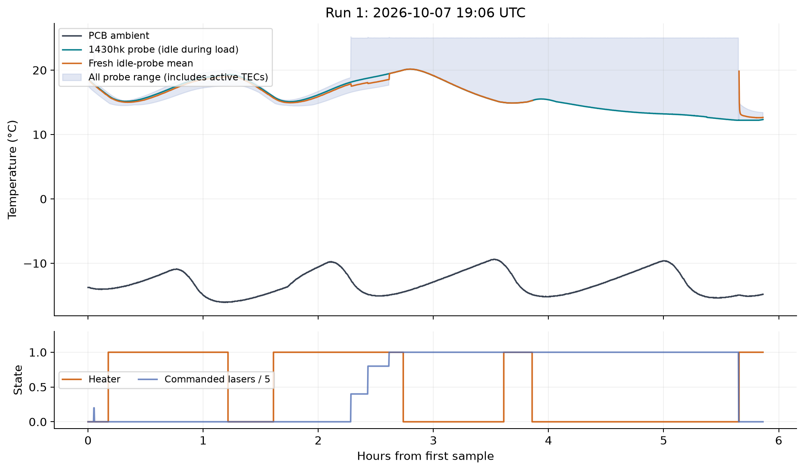
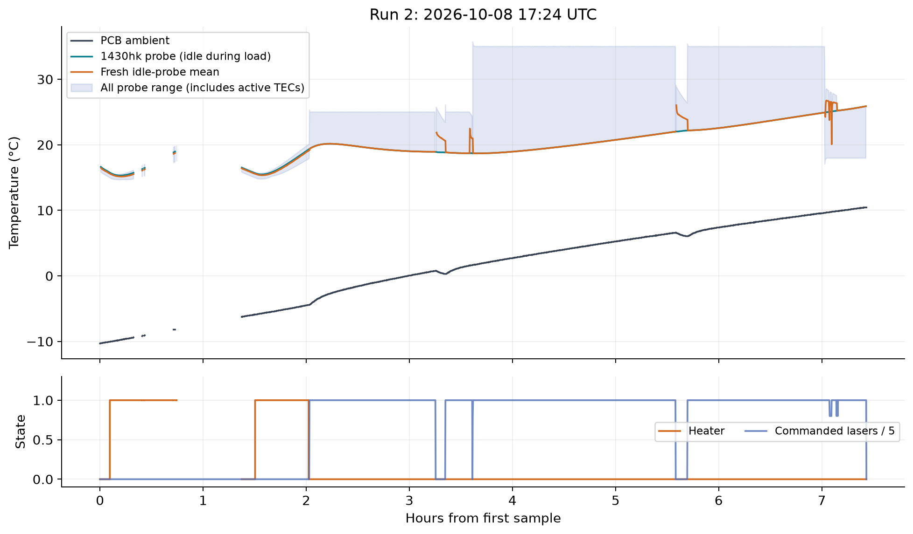
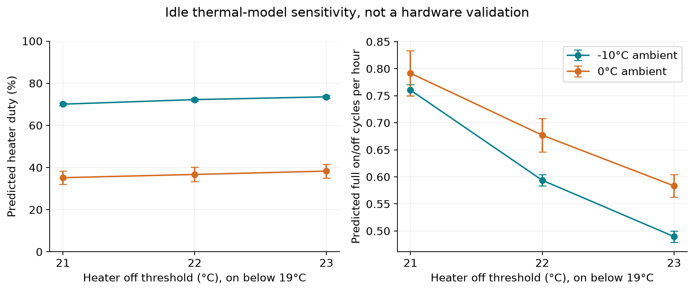
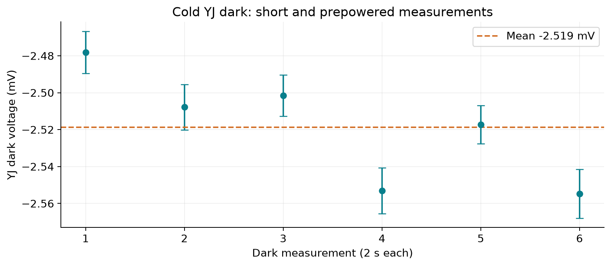
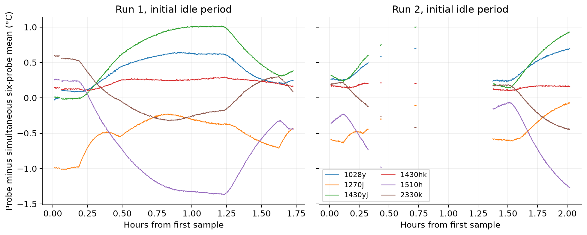
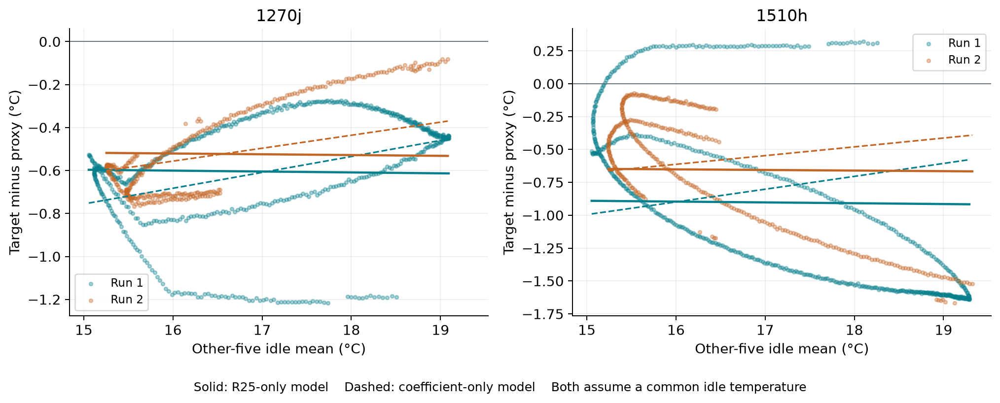
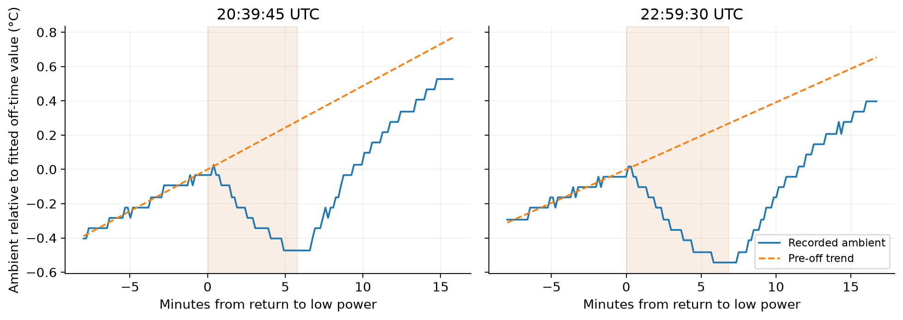

# Laser-bank freezer test, 7–9 October 2026

Analysis date: 9 October 2026. All times below are UTC. Thermal fits use the
archived notebook captures. A separate live debugger investigation is identified below;
no controller settings were changed.

## Results

The enclosure and heater demonstrated a substantial temperature rise above the
PCB ambient sensor during the freezer test. The original heater policy allowed
idle diodes to fall below their configured start window. The approved replacement
policy turns the heater on when **any fresh idle TEC reads below 19°C** and off
when **all fresh idle TECs read above 21°C**. The archives predate this change.

| Quantity | Result | Interpretation |
| --- | --- | --- |
| Cold YJ photodiode dark | **−2.51875 mV**; between-measurement SD 0.03014 mV, six 2 s averages | Approximately 1.500 mV below the cached laboratory dark |
| New-band idle heater duty at −10°C | **69–71% estimated** | Constant-ambient thermal-model sensitivity, awaiting measurement |
| New-band idle heater duty at 0°C | **32–38% estimated** | The short measured zero-duty interval at 0°C was a warming transient |
| New-band idle heater-free ambient | **Approximately +6 to +10°C estimated** | Extrapolation; no steady idle sweep establishes a threshold |
| Loaded operation | Zero heater duty observed from approximately −4.4 to +10.4°C during qualified five-TEC intervals | Applies to those loads and thermal history; no universal ambient cutoff |
| Initial low-load enclosure rise | Mean idle probes **27.9–35.1°C above PCB ambient** in run 1 | Observed temperature difference, not a steady maximum capacity rating |
| Ambient load divot | Raw drops **0.38 and 0.50°C**; detrended deficits **0.73 and 0.79°C** | Load-associated sensor response; component attribution remains unproven |

At −15°C the new-band model predicts roughly 88–90% duty and minimum idle
temperature **17.5–17.8°C** after turn-on. Heater lag therefore remains important:
a 19°C switching threshold does not guarantee an 18°C minimum or immediate
startability. This needs a cold-soak validation before telescope use.

## Captures and analysis boundaries

| Archive in `tools/temp_data/` | Actual sample interval | Samples | Recorded ambient |
| --- | --- | ---: | --- |
| `temp_20261007T190615_212906Z.pkl` | Oct 7 19:06:18.277 to Oct 8 00:58:05.419 | 2,101 | −16.06 to −9.38°C |
| `temp_20261008T172437_042289Z.pkl` | Oct 8 17:24:40.145 to Oct 9 00:50:36.742 | 2,307 | −10.31 to +10.44°C |

Both captures report firmware `5dfd966e74a9-dirty`, boot count 115. The exact
dirty source state is not reconstructible from that identifier alone. The saved
notebook supplies operator intent; command responses and engineering records
provide evidence of what actually happened.

Run 1 has no sample errors or intervals above 20 s. Run 2 has 12 sample errors
and 14 intervals above 20 s, totaling 60.58 minutes of excluded intervals.
Host suspension and recording interruptions make wall time and notebook elapsed
time disagree. Calculations use sample issue UTC, exclude long intervals, and
break plotted lines across gaps. The run-1 outcome stop timestamp was written
later than its last sample; it is not the duration of the temperature record.

Command acknowledgements establish requested load, not proof of optical emission.
Load classification uses successful commands rather than attempted starts.
The five-TEC class additionally requires the heater status to report one idle
TEC. It does not establish maximum electrical load or stable emission by every
laser. Short photodiode measurements occur during otherwise low-load periods.





The shaded all-probe range includes actively regulated TECs. Those temperatures
are not enclosure thermometers. The fresh idle-probe average can jump when the
membership changes; such a jump is not an instantaneous enclosure temperature
change. The 1430hk probe remained an idle reference during the five-TEC load.
Unavailable or stale aggregates should not be interpreted as valid bank readings.

## Heater duty and temperature rise

### Measurements under the original policy

Duty is time weighted: hold each sampled heater state until the next sample and
divide included on-time by included duration. Include intervals of at most 20 s
with auto heater mode, bank powered, no sample error, and poll age at most 20 s.
Ambient bins are the stated center ±1°C. Initial low load means zero positively
commanded lasers and zero energized FVOAs. Five-TEC intervals require five
positively commanded lasers and one reported idle TEC. These bins mix thermal
transients and are not equilibrium duty measurements.

| Capture / load | Ambient bin | Included minutes | Measured duty |
| --- | ---: | ---: | ---: |
| Run 1, low load | −15°C | 61.57 | 50.7% |
| Run 1, low load | −10°C | 4.03 | 100% |
| Run 1, five TECs | −15°C | 17.43 | 69.3% |
| Run 1, five TECs | −10°C | 22.96 | 11.7% |
| Run 2, low load | −10°C | 19.67 | 73.5% |
| Run 2, low load | 0°C | 5.36 | 0% |
| Run 2, five TECs | 0°C | 41.14 | 0% |
| Run 2, five TECs | +5°C | 50.72 | 0% |
| Run 2, five TECs | +10°C | 35.96 | 0% |

One complete low-load cycle, Oct 7 19:16:50.915 to 20:42:56.994, lasted
86.10 minutes with 72.48% heater duty. Time-weighted PCB ambient was −13.84°C
(range −16.06 to −10.88°C). The coldest probe ranged from 14.49 to 17.68°C,
while the six-probe mean ranged from 15.01 to 19.02°C. This directly shows why a
15°C turn-on threshold was inadequate for a compiled 17°C minimum, particularly
with controller start blocking and thermal lag. After turn-on near 15°C, the
coldest readings continued down to about 14.4–14.8°C before recovering.

During the initial all-idle periods, run 1 sustained an observed mean-probe rise
of 27.93–35.05°C and coldest-probe rise of 26.80–33.69°C above PCB ambient.
Run 2 ranges were 20.98–26.99°C and 20.42–26.07°C respectively. These include
warming/cooling history and bank self-heating. They demonstrate enclosure
performance but do not establish the maximum sustainable temperature difference
under constant ambient. A heater input-power measurement and steady soak would
be needed for a thermal conductance or wattage claim.

### Estimates for the approved 19–21°C policy

The comparison uses a small empirical model of the initial idle 1510h reading,
usually the coldest probe, driven by measured PCB ambient and heater state:

```text
dh/dt = (u − h) / τ
dT/dt = a h − b (T − A) + c

T: 1510h reported temperature, °C
A: PCB ambient, °C
u: observed heater relay state, 0 or 1
h: delayed heater influence, dimensionless
t: minutes
```

Fit three-minute temperature slopes against the mean delayed heater influence
and temperature difference. Use τ of 12 and 16 minutes, fitting run 1 alone and
both runs pooled, giving four sensitivity cases. Discard the first 2τ of each
continuous fitting segment and reset at gaps over 24 s. Fit only the initial
all-idle periods, ending at Oct 7 20:50 and Oct 8 19:26. The parameter `c`
absorbs idle heating and sensor/reference bias; it is not a measured heat input.
Coefficients and sample counts are in [results.json](temp_test_figures/results.json).

Run-1-only models replay the withheld Oct 8 18:46:57.660–19:26:03.538 segment
with temperature RMSE 0.22–0.24°C, initializing at the observed temperature and
assuming zero delayed heater influence. Pooled-model replay is not independent
validation. Simulations use constant ambient, 0.1-minute steps for 72 hours, and
summarize the final 48 hours. Model ranges below show sensitivity to these four
fits, **not statistical confidence intervals**. Spatial gradients, sparse cycles,
changing ambient bias, and using one probe as a proxy limit extrapolation.

| Ambient | Off threshold; on below 19°C | Duty estimate | Full cycles/hour | Predicted minimum |
| ---: | ---: | ---: | ---: | ---: |
| −10°C | **21°C, selected** | **69.4–70.8%** | 0.75–0.77 | 18.15–18.29°C |
| −10°C | 22°C | 71.7–72.8% | 0.58–0.60 | 18.02–18.20°C |
| −10°C | 23°C | 72.9–74.2% | 0.48–0.50 | 17.91–18.16°C |
| 0°C | **21°C, selected** | **32.1–38.3%** | 0.75–0.83 | 18.80–18.86°C |
| 0°C | 22°C | 33.3–40.2% | 0.65–0.71 | 18.79–18.86°C |
| 0°C | 23°C | 35.1–41.5% | 0.56–0.60 | 18.78–18.85°C |
| −15°C | **21°C, selected** | **87.6–89.7%** | 0.35–0.42 | 17.48–17.80°C |



The selected 21°C upper threshold uses less heater energy and avoids the long
recovery cycles of higher thresholds. The predicted −15°C minima still need
attention. Some models cannot reach 22–23°C at −15°C even with continuous heat.
The modeled full-heater equilibrium rise of roughly 36.8–38.1°C is an
extrapolation, not an enclosure rating.

The idle heater-free ambient estimate is `19 − c/b`, approximately +6 to +10°C.
Internal active-load heat can remove heater demand at much lower ambient:
qualified loaded intervals had zero duty from about −4.4 through +10.4°C.
The low-load 0°C bin lasted only 5.36 minutes after prior heating, so it does not
contradict the estimated steady idle duty at 0°C.

## Cold YJ dark

| UTC, Oct 7 | Dark mean (mV) | Reported SEM (mV) | PCB ambient (°C) | Nearest sampled PD on-time (s) |
| --- | ---: | ---: | ---: | ---: |
| 19:12:41.536 | −2.478125 | 0.011386 | −14.00 | 0* |
| 19:13:24.213 | −2.507812 | 0.012340 | −14.00 | 38 |
| 20:19:14.919 | −2.501563 | 0.011156 | −16.00 | 0* |
| 20:19:57.553 | −2.553125 | 0.012412 | −16.00 | 40 |
| 20:43:41.251 | −2.517188 | 0.010362 | −14.38 | 1231 |
| 20:44:13.905 | −2.554688 | 0.013293 | −14.25 | 1271 |

Each average lasts 2 s. *Zero is a nearby pre-command state, not a dark sampled
with the PD off or at zero settling time. The dark command enforces the existing
10 s PD power-on settling interval. The latter pair followed about 20 minutes
of powered operation.



The mean is −2.518750 mV with between-average SD 0.030136 mV and range
−2.554688 to −2.478125 mV. Within-window RMS is 0.0655–0.0841 mV. The archive
contains a cached laboratory reference of −1.018750 mV, giving a cold shift of
−1.500000 mV. The original reference acquisition time and temperature are not
preserved in this capture, so this is a comparison to that saved reference,
not a fitted temperature coefficient.

There is no large warm-up effect comparable to the 1.5 mV cold shift. Differences
of roughly 0.03–0.05 mV within successive pairs remain visible. Six averages
cannot establish exact independence from PD on-time. Repeating matched settling
times at controlled temperatures would distinguish time and temperature effects.

## Idle TEC differences and calibration limits

Only the initial all-six-idle, fresh, powered-bank intervals are used. Subtract
the simultaneous six-probe mean from each reported temperature. The SD below
describes variation over the interval, not uncertainty on a calibration constant.

| Probe | Run 1 residual, mean ± SD (°C) | Run 2 residual, mean ± SD (°C) |
| --- | ---: | ---: |
| 1028y | +0.403 ± 0.202 | +0.419 ± 0.159 |
| 1270j | −0.504 ± 0.219 | −0.430 ± 0.181 |
| 1430yj | +0.607 ± 0.352 | +0.470 ± 0.255 |
| 1430hk | +0.221 ± 0.055 | +0.155 ± 0.027 |
| 1510h | −0.753 ± 0.537 | −0.556 ± 0.385 |
| 2330k | +0.027 ± 0.279 | −0.058 ± 0.228 |



The median instantaneous spread was 1.58°C in run 1 and 0.92°C in run 2,
with maxima 2.38 and 2.40°C. The following fit adopts the owner's useful working
assumption that idle diodes share a physical temperature. It quantifies the
resistor/coefficient explanations before testing that assumption.

### Constraints on R25 and coefficient

For each target, use the mean of the **other five** idle readings as a reference.
This avoids including the target in its own reference. Fits use the original
initial-idle cutoffs above, finite readings, and duration weights for contiguous
fresh intervals no longer than 20 s: 102.15 minutes in run 1 and 59.46 in run 2.
The reference spans approximately 15–19°C. Its absolute calibration is assumed.

The actual internal coefficient was not archived. For comparison, normalize the
reference and target to 10 kΩ at 25°C and B=3911 K, the rounded equivalent of the
FLC −4.4 %/°C sheet value. These are **equivalent errors under that model**,
including controller conversion/calibration effects, not measured resistances.
A different common B scales inferred R25 errors but leaves the relative B-only
ratios below unchanged. This model does not identify physical resistor error
separately from controller electronics.

| Diode | R25-only error %, run 1 / 2 | Coefficient-magnitude change %, run 1 / 2 | Heating minus cooling residual °C, run 1 / 2 |
| --- | ---: | ---: | ---: |
| 1028y | -2.21 / -2.29 | -5.63 / -5.49 | +0.32 / +0.21 |
| 1270j | +2.85 / +2.47 | +7.84 / +6.38 | +0.34 / +0.15 |
| 1430yj | -3.32 / -2.55 | -8.34 / -6.01 | +0.50 / +0.30 |
| 1430hk | -1.22 / -0.86 | -3.18 / -2.12 | +0.06 / +0.04 |
| 1510h | +4.29 / +3.10 | +10.33 / +7.03 | -0.65 / -0.37 |
| 2330k | -0.15 / +0.29 | -0.76 / +0.39 | -0.49 / -0.29 |

R25-only fits imply approximately **9.67–10.43 kΩ**, entirely within the supplied
9.5–10.5 kΩ specifications. Thus nominal resistor variation can explain the mean
offsets without requiring a slope change. FLC's two reports record 10,000 Ω
without measurement uncertainty, so the equivalent deviations are also candidates
for conversion/calibration error rather than proof those units changed resistance.

Coefficient-only fits require −8.34% to +10.33% slope-magnitude changes in run 1,
and −6.01% to +7.03% in run 2. For 1270j this would imply approximately
−4.74 / −4.68 %/°C; for 1510h, −4.85 / −4.71 %/°C under the stated model.
These describe the change needed *if R25 is exact and the proxy is correct*.
They are not settings recommendations. A B change produces no correction at
25°C, while an R25 error remains there, providing a useful discriminator in a
future warm equilibrium measurement.



At the same reference temperature, heating and cooling branches differ by up
to 0.65°C in run 1 and 0.37°C in run 2. The table compares residuals in matched
0.25°C reference bins, weighting the common branch duration; local five-minute
slopes above +0.005°C/min or below −0.005°C/min identify the branches. Matched
coverage is approximately 39–40 and 17–18 minutes per diode. A fixed R25/B model
cannot explain this direction dependence. It is evidence to check settling,
thermal lag/gradients and the proxy assumption before applying a static trim.

Allowing both parameters reduces residuals but yields the following joint fits:

| Diode | Joint R25 error %, run 1 / 2 | Joint coefficient-magnitude change %, run 1 / 2 | Fit RMSE °C, run 1 / 2 |
| --- | ---: | ---: | ---: |
| 1028y | -5.76 / -7.50 | +10.06 / +13.65 | 0.19 / 0.12 |
| 1270j | +0.19 / -4.59 | +7.32 / +18.14 | 0.24 / 0.11 |
| 1430yj | -9.99 / -11.01 | +19.39 / +22.61 | 0.32 / 0.18 |
| 1430hk | -2.20 / -1.14 | +2.72 / +0.70 | 0.05 / 0.03 |
| 1510h | +16.10 / +17.52 | -30.10 / -33.37 | 0.46 / 0.24 |
| 2330k | +4.03 / +8.45 | -11.29 / -19.71 | 0.29 / 0.16 |

The large joint corrections for 1430yj and 1510h exceed the nominal R25 tolerance,
and several channels change appreciably between runs. Over a narrow cold span,
slope and offset trade against one another and fit thermal history. These results
constrain plausible explanations but do not support adopting the joint fit.

For reproducibility, let `x=1/T_proxy−1/298.15` and `z=1/T_target−1/298.15`
(temperatures in kelvin). Fit `z=c+b*x`. R25-only fixes `b=1`, with
`R25/10000=exp(3911*c)`; coefficient-only fixes `c=0`, with required B ratio `b`.
The joint fit estimates both. Full values, input hashes and plotted points are
in [results.json](temp_test_figures/results.json).

### Datasheets, controller limits, and settings

The supplied [Maiman SF manual](datasheets/maiman%20sf8025.pdf), printed page 5
(PDF page 6), specifies a **15–40°C control range**. The application's **17–38°C**
compiled window and **25°C target** are separate settings. The heater now uses
**19–21°C idle probes**. During these archives it used the original 15°C turn-on
and, in the cold-ambient regime, 20°C turn-off. That policy let other diodes fall
below their configured start window.

The controller blocks both cold and hot TEC conditions. A reading slightly above
the configured lower bound does not prove start permission has recovered. The
1510h start succeeded after changing its range to 16–38°C. These samples do not
establish a fixed recovery hysteresis or a universal calibrated minimum.

The source comparison now uses the installed-model sheets and the two supplied
FLC unit reports:

| Source | Relevant evidence |
| --- | --- |
| [FLPD-1028-50-DFB-BTF](datasheets/FLPD-1028-50-DFB-BTF.pdf), p. 2 | R25 9.5–10.5 kΩ, coefficient −4.4 %/°C, operating 10–40°C, diode maximum 250 mA, TEC maximum 1.2 A |
| [BF69016 report](datasheets/FLPD-1028-50-DFB-BTF_%23BF69016_testreport.pdf), p. 1 | R25 10,000 Ω at 25°C; threshold 14.5 mA; bias/maximum 250 mA; test operating temperature 25°C; no coefficient/B measurement |
| [FLPD-2330-03-DFB-BTF](datasheets/FLPD-2330-03-DFB-BTF.pdf), p. 2 | R25 9.5–10.5 kΩ, coefficient printed −4.4 with units 1/°C; operating 10–40°C, diode maximum 120 mA, TEC maximum 1.2 A |
| [D4520009 report](datasheets/FLPD-2330-03-DFB-BTF_%23D4520009_testreport.pdf), p. 1 | R25 10,000 Ω at 25°C; threshold 24.9 mA; bias/maximum 120 mA; test operating temperature 25°C; no coefficient/B measurement |
| [Aero 1270](datasheets/1270-nm-laser-diode-Model-1-Datasheet.pdf), [1430](datasheets/1430-nm-laser-diode-Model-1-Datasheet.pdf), [1510](datasheets/1510-nm-laser-diode-Model-1-Datasheet.pdf), p. 1, rev. 08/23, vendor annotations | R25 9.5–10.5 kΩ; B=3900 K; model-sheet operating current typical 60 mA, maximum 70 mA; TEC maximum 1 A; case operating −20 to +60°C |
| Maiman, printed pp. 15–16, 19–20 (PDF pp. 16–17, 20–21) | PID examples, oscillation cautions, separate internal/external B registers, and an ambiguously named TEC calibration register; its effect needs live testing |

The 2330 sheet's −4.4 is interpreted as **%/°C**, consistent with the 1028 sheet
and a 10 kΩ NTC. That interpretation is an inference: the printed 1/°C label
would imply a physically implausible fractional slope if taken literally. Obtain
vendor confirmation before using it as a replacement calibration specification.
FLC's case rating is −5 to +70°C. Case temperature, controlled diode temperature and PCB ambient are distinct;
the Aero case range does not widen the Maiman controlled-temperature range.

#### Internal versus external coefficient: corrected mapping

The system uses the **internal LD thermistor** at **0x007F** for coefficient
programming and readback. No external NTC is installed; external register
0x008A is unused. The SF manual's service-address equivalents are `0B0E` for
internal LD B and `0A1F` for external B.

Compiled defaults use vendor values: −4.4 %/°C for FLC (rounded B=3911 K) and
B=3900 K for Aero. These are not unit-specific thermistor measurements.
The existing unit conversion, app persistence and profile-programming flow
remain unchanged. The external register remains available under its raw service
names but has no role in the laser coefficient setting.

#### Two calibration addresses and the live test

| Calibration | Modbus / service address | Current exposure | Manual evidence |
| --- | --- | --- | --- |
| LD current | 0x0088 / `030E` | `current_cal_pct` | Current set calibration, 100.00% default, 95–105%, 0.01% steps |
| TEC calibration | 0x007E / `0A1E` | Getter only; no public setting | Table calls it current set calibration; specification says TEC temperature set calibration, same range/steps |

The owner flashed and attached matching firmware `cbe6624d130d-dirty`, boot 122,
before the controlled trial. Initial bank policy was auto/on, heater off, all six
TECs idle, ambient 21.62°C and idle mean 27.45°C. Differing sensor locations and
thermal history prevent using that ambient-to-idle difference as a calibration
offset. The 1270j controller identity was device 0x1113, serial 8228, matching
configuration. Both calibration registers read 100.00%.

Changing 0x007E to 99% while the TEC was stopped left its temperature readback
approximately unchanged (27.20–27.22°C). The TEC-only trial then compared
100%, 99% and restored 100% at three digital targets. Emission stayed off and
measured LD current was zero in every captured sample. PID, current limits and
both NTC coefficients stayed unchanged. The table uses the final three samples
of each short plateau; these are controller readbacks, without an independent
physical-temperature reference.

| Digital target °C | Reported at 100% °C | Reported at 99% °C | Restored 100% °C | 99% minus 100% °C |
| ---: | ---: | ---: | ---: | ---: |
| 18 | 18.010 | 17.837 | 18.023 | −0.173 |
| 25 | 25.013 | 24.753 | 25.003 | −0.260 |
| 32 | 32.003 | 31.690 | 32.003 | −0.313 |

At factory 100%, the reported temperature matches each target within about
0.02°C. The 99% trial introduced an offset. Its effect approximately follows
`reported_temperature_c = digital_target_c × calibration_pct / 100` over these
three targets, with maximum prediction difference 0.017°C in the plateau means.
This is an empirical description, not a claim about internal electronics.

The initial 25°C result alone could also reflect reduced heating power. The
cooling-side 18°C comparison is important: reducing cooling drive alone should
warm the diode, whereas 99% lowered the reading there too. This argues against
merely scaling Peltier drive current. A reference/sense-current contribution
inside the controller remains possible; this test does not identify its circuit.
The TEC current register has 0.1 A resolution and voltage 0.1 V. Near equilibrium,
zero readings do not establish zero drive. The cooling trial read 100 mA and
0.2 V, while 32°C samples included −0.1 V.

**Disposition: retain factory 100%.** There is no observed digital-setpoint
regulation error needing correction, and no evidence here of an LD current
calibration problem. An electrical current-accuracy claim would require an
independent measurement. Keep `current_cal_pct` unchanged and add no TEC setting
or calibration-field rename. Treat 0x007E as an engineering adjustment to
investigate if a future settled reading misses its target. An R25/absolute
thermistor error is a separate question: agreement between the controller's
target and its own readback does not establish physical temperature accuracy.

The temporary probes used the owner's existing serialized Modbus path, changing
encoded requests at `mbc_send_cmd`. FC16 responses acknowledged each register
write. The original FC3 read validator then rejected those instrumented
write-trigger queries, producing expected query errors; those errors are not
failed controller writes. Debugger pauses also coincided with isolated PD ADC
discard warnings. No permanent instrumentation, external NTC writes, LD START
or LD-current writes, reset, reflash, automatic ramp or explicit EEPROM SAVE
was added. Controller state commands retain their own persistence behavior.

TEC START initially acknowledged but remained stopped with the physical
interlock permission enabled. The trial used the same DENY_INTERLOCK prerequisite
as normal profile preparation, then restored the original permission. Final
verification confirmed TEC calibration 100% (raw 0x2710 from 0x007E), the original
18°C digital target, all six LDs/TECs stopped, unchanged PID/current limits,
LD calibration, PCB settings and bank/heater policy, and no reboot. Temporary
breakpoints are gone; the user's five breakpoints and running attached session
remain. Raw queries, traces and debugger evidence are in
[the Oct 9 capture](../tools/temp_data/ntc_calibration_20261009.json).

#### Other coded/controller/vendor differences

| Quantity | Compiled / archived | Vendor comparison and disposition |
| --- | --- | --- |
| Temperature window / target | Compiled 17–38°C / 25°C; archived 1510h and 2330k trials include 16–38°C and changed targets | Maiman 15–40°C; FLC operating 10–40°C and reports at 25°C. Retain compiled window/target; start tests must include recovery hysteresis and startup undershoot |
| TEC current limit | FLC 1.2 A; Aero 1 A, agreeing with archived readbacks | Matches supplied diode maxima; no change |
| PID, 1028y / 2330k | 20 / 1000 / 1000 in code and archive | Matches Maiman's DFB example. 2330k already used it; its cold-start issue is not omission of that profile |
| PID, Aero channels | 100 / 1000 / 0 in code and archive | Matches Maiman's default, although these are DFB diodes. The manual recommends trying the DFB profile for problematic DFB behavior; this merits a controlled comparison, not automatic gain substitution |
| Normal diode-current maximum | 1028y 250 mA, 2330k 120 mA, Aero 60 mA, agreeing with archive | FLC maxima 250/120; Aero typical 60, maximum 70. Compiled normal maxima match FLC limits and are conservative for Aero |
| OCP acceptance ceiling (`dne_current_ma`) | 1028y 275; 2330k 137; 1270j 75; other Aero 72 mA | Higher than the sheet maxima 250/120/70. This is the firmware acceptance ceiling for a physical protection potentiometer, not the commanded current maximum; remains unchanged pending owner review |

The observed physical OCP thresholds were:

| Channel | Archived range (mA) | Sheet current maximum (mA) |
| --- | ---: | ---: |
| 1028y | 261.5–265.5 | 250 |
| 1270j | 66.3–68.6 | 70 |
| 1430yj | 66.1–68.3 | 70 |
| 1430hk | 65.0–68.2 | 70 |
| 1510h | 67.8–70.1 | 70 |
| 2330k | 131.3–134.3 | 120 |

FLC's observed protection trips exceed the stated diode maxima even though normal
commanded maxima agree. The pot setting needs an independent protection review;
do not lower or retune it from this archive alone. PID, coefficient, startup step,
thermal conditions and protection are separate hypotheses. Maiman also cautions
that high derivative gain can amplify noise and that integral settings can cause
oscillation (printed p. 16); the DFB example is not a universal optimum. Retain
all current/PID/temperature limits in this implementation. A later authorized
trial should change one quantity at a time, retaining engineering readbacks,
settling traces and autonomous-stop warnings. No automatic ramp is added.

### Replacement-diode procedure

1. Save diode model/serial, controller identity, actual internal B (0x007F),
   LD/TEC calibration registers (0x0088/0x007E), target, PID and protection/current
   limits. Record sheet R25/slope and the unit report. Use firmware with the corrected
   internal mapping before relying on `ntc_coeff_pct_per_c` for this task.
2. With emission and TEC regulation off and the bank powered, record all idle
   probes through comparable equilibria. Use the other-five mean as the relative
   reference and compare the replacement with this baseline. Hold heater/load
   conditions fixed and retain heating/cooling branches separately.
3. Fit R25-only, coefficient-only and joint explanations as above, using each
   driver's actual conversion. A shift at 25°C favors R25/conversion offset;
   a repeatable change in slope across temperatures favors B. The existing cold
   span cannot reliably separate both. A fixed correction should agree across
   runs and heating/cooling branches before adoption.
4. For an absolute result, later measure thermistor resistance at multiple known
   equilibria with a multimeter and suitable contact reference. Service isolation
   must avoid loading the live sense circuit. Fit `ln(R)` versus `1/T_K` for R25
   and B. Alternatively use temperature readbacks against the contact reference,
   with known controller conversion; that method also includes controller
   electronics errors. Retain factory 0x007E unless settled regulation itself
   fails to match its digital target. A proposed settling check is
   drift below 0.02°C/min for 10 minutes plus spatial checks. Safe example points
   are 18, 25 and 35°C, subject to diode/controller limits.
5. Review a supported correction before writing. The 10 kΩ resistor is physically
   fixed. B adjusts slope; it cannot fix R25 bias at 25°C. Today's 0x007E trial
   introduced target/readback error, so it is not an established solution for
   physical R25 error. Use independent references to evaluate a setpoint
   correction, vendor calibration or a matched replacement thermistor. Keep
   protection bounds independent of display/calibration changes.
6. After an approved API/mapping correction, apply accepted calibration without
   persistence, verify actual readback and repeat the equilibrium points. Check
   cold/hot starts, TEC settling and autonomous stops before explicitly accepting
   persistence. Preserve raw records and serial history.

| Avenue | Benefit | Limitation / prerequisite |
| --- | --- | --- |
| Other idle diodes as reference | Immediate relative R25/B constraints, no extra instrument | Common-temperature/known-conversion assumption; no common absolute error detection |
| Multi-temperature contact reference | Tests absolute readback and any demonstrated trim | Reference uncertainty, placement and thermal gradients enter the result |
| Multimeter plus reference, later | Separates physical R25/B from controller electronics | Needs suitable service access/isolation and temperature equilibrium |
| Controller calibration | Engineering option if settled readback misses the digital target | Factory 100% already matches here; absolute R25 compensation needs separate validation |
| Vendor calibration / matched thermistor | Addresses a physical R25 error at source | Service/replacement effort, then repeat the baseline |
| Wavelength thermometry | Independent diode-temperature indicator | Requires unit-specific wavelength versus temperature/current calibration |

The archive supports useful **relative constraints under the common-temperature
assumption**, but not an absolute calibration or a unique R25/B decomposition.
The documented controller coefficient uses the internal register; external NTC
register 0x008A has no role in this system.

## PCB ambient response to load changes



| Load-off UTC, Oct 8 | Low-power duration | Raw decline | Deficit below extrapolated warming |
| --- | ---: | ---: | ---: |
| 20:39:45.607 | 5.79 min | 0.38°C | 0.73°C |
| 22:59:30.647 | 6.84 min | 0.50°C | 0.79°C |

Fit a straight warming trend from 8 to 1 minutes before each transition. Compare
the last minute before load restoration with that extrapolation. Raw decline
compares that last minute with the final six pre-transition samples in the fit
window. Pre-transition warming slopes were 0.0487 and 0.0391°C/min.

The response is consistent with local load-dependent heating or a measurement
bias. FVOAs 6–12 are a plausible source given the owner's physical-layout
observation. Lasers, FVOAs, and PD loads changed together, however, so this
record cannot attribute the effect to that group or establish an ADC scale
error. A later test should switch the suspected FVOA group alone, then lasers
alone, with a separate ambient reference and comparable dwell times. PCB ambient
should retain a roughly degree-scale load-dependence caveat in thermal estimates.

## Commissioning validation

Replay these archives first. For a later explicitly authorized live run, record
the firmware revision, actual controller settings, independent ambient reference,
load transitions, and fresh per-diode temperatures. Observe cooldown without
changing heater policy mid-phase. At stable −10°C and 0°C, acquire multiple
complete idle heater cycles, minima after turn-on, maxima after turn-off, and
relay cycle rate. Add a −15°C capacity check before asserting that the bank
remains startable over the full intended range.

Take matched YJ darks after the normal settling interval and prolonged power-on.
Only after reviewing the idle record should the operator enable the high-load
phase. Verify actual TEC/LD operation and measured currents, then isolate the
FVOA ambient effect with single-subsystem steps. Stop and save through the
notebook's explicit end-test action, preserving raw records even if analysis
fails. The separate [notebook update prompt](temp_test_update_prompt.txt) describes
the requested archived replay and future commissioning preamble.

## Data provenance

Full numerical results and editable-chart source arrays are in
[results.json](temp_test_figures/results.json). SVG versions sit beside each PNG.
These are analysis products, not new firmware telemetry or host APIs.

| Input | SHA-256 |
| --- | --- |
| Run 1 pickle | `8ef8ebe5c7fbfad042dd5adef3bb69fd3de408af5bf482074baf08f1ea1547cb` |
| Run 1 log | `41d47c20c10bfcff05c6f61eab06222109dec3fd733bb705b699a9d745e21d7a` |
| Run 2 pickle | `37205445a1dad8a099d2b81ba6de8a0691176bab752ae7640c365886b7374fa7` |
| Run 2 log | `59f44057cab69426b219cc886b79c35ca3c1826cf62f6cf4012777698e2b9ca5` |
| Oct 9 debugger capture | `3f95e7428cea342ad2ddd745f0e2dc27baf89294cf2aab6d340efd13e4df4137` |

Software footnote: the archive records a 2330k output-fault warning a few seconds
after an acknowledged start, followed by both TEC and LD stopped. The brief
thermal excursion was not sampled at its trigger. The approved heater policy and all
A–H changes in [temp_test_change_proposals.md](temp_test_change_proposals.md)
are implemented. Failure replies retain available controller evidence; compact
status adds output_state while readiness describes public start blockers;
eligible background checks detect LD-only stops and freeze confirmed stopped
component counters; heater overrides continue observation; temps() uses idle
probes; notebook low-power transitions stop channels without bank cycling; the
PCB power helper uses measured output currents; H synchronizes the thermistor
coefficient in datasheet units; the follow-up corrects internal register selection.
Original A–H verification used temporary native/fake-client/archive checks and
the Nucleo build. The separate Oct 9 live investigation above adds register
readbacks and bounded TEC-only trials. The mapping correction passes the Nucleo
build and has not been flashed; no live notebook was executed by the agent.
Target timing, post-flash synchronization and thermal/start behavior remain
in [human_review_required.md](human_review_required.md). The refreshed editable
presentation is intentionally uncommitted.
